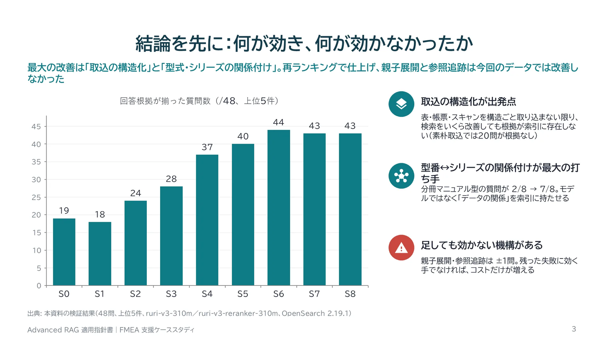
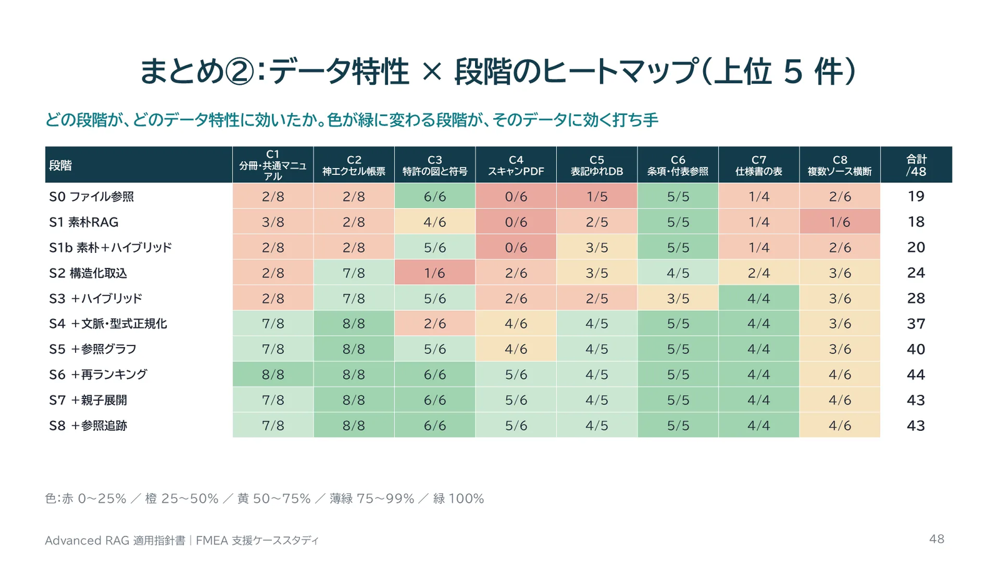
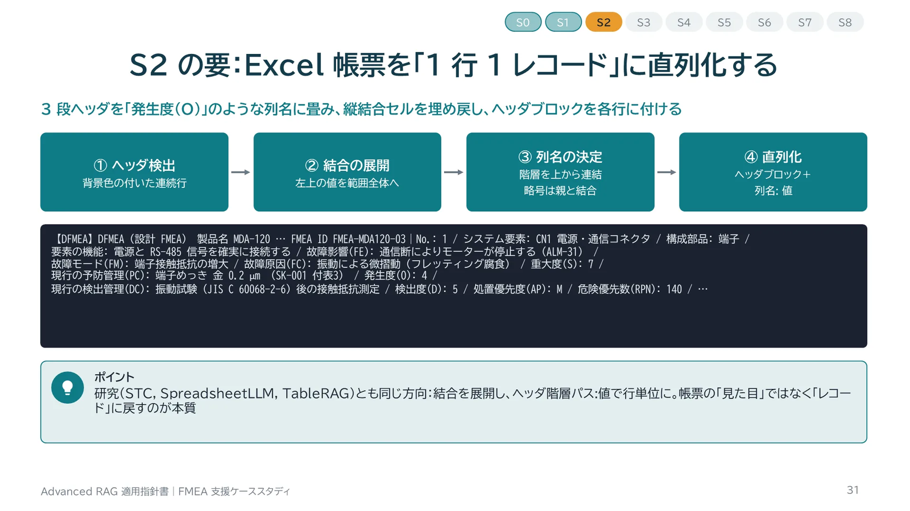
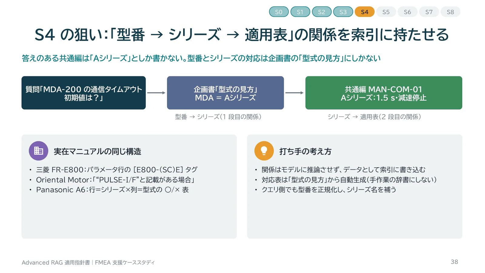
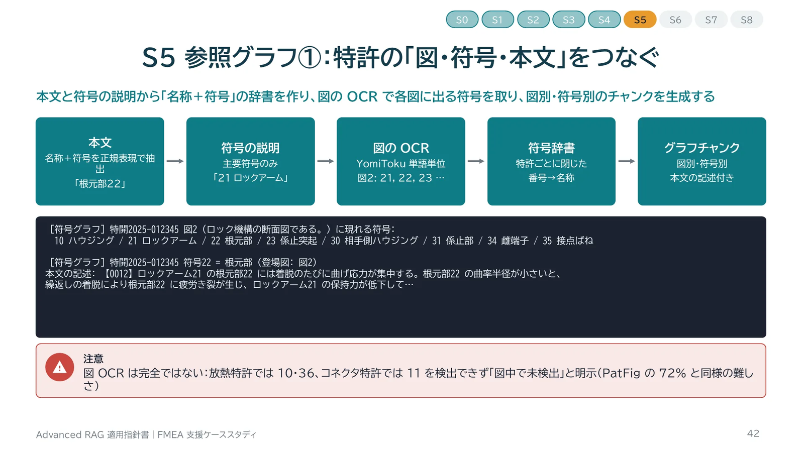
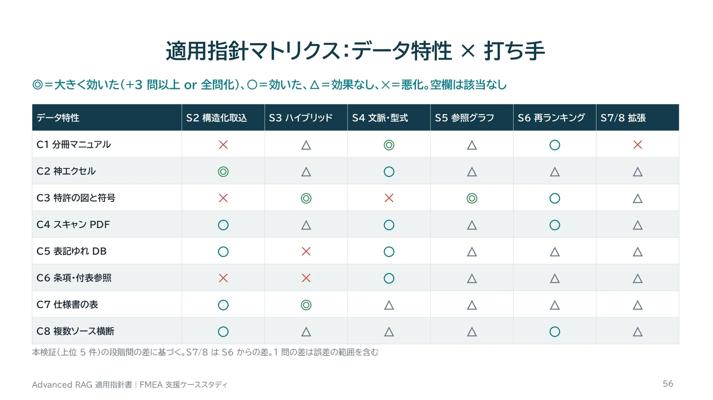

:::message
この記事は、生成AIを使って作成し、筆者が内容を確認・修正したうえで公開しています。
:::

Advanced RAG の手法は、名前と仕組みを覚えても、目の前のデータに何が効くのかが分かりません。分からないままでは、プロジェクトで起きた失敗に仮説を立てられず、検証の指示も出せません。この記事は、FMEA 作成支援 RAG を題材に、分冊マニュアル・神エクセル・特許の図と符号・スキャン PDF などのデータ特性ごとに、どの打ち手がどれだけ効くかを WSL2 上の OpenSearch で段階的に実測した結果をまとめます。

48 問の評価用質問で、回答に必要な根拠が上位 5 件に揃った問数は、素朴な RAG の 18 問から、構造化取込・ハイブリッド検索・型番とシリーズの関係付け・参照グラフ・再ランキングを重ねて 44 問になりました。表を表ごと読む親子展開と、別冊への参照追跡は、このデータでは改善しませんでした。

- スライド(実践編、76 枚): [Web スライド](https://takenori-kusaka.github.io/advanced-rag-fmea-casestudy/)
- スライド(前提編「Advanced RAG 実践ガイド」、96 枚): [Web スライド](https://takenori-kusaka.github.io/advanced-rag-fmea-casestudy/guide/)
- コード・合成コーパス・結果: [GitHub リポジトリ](https://github.com/Takenori-Kusaka/advanced-rag-fmea-casestudy)

## 1. 題材とデータ

RAG は、質問に近い文書を検索し、その文書を根拠として生成AIが答える方式です。題材は、生成AIで FMEA を作成する支援の仕組みです。FMEA は、製品の故障のしかたと原因・影響を洗い出し、対策の優先度を決める品質の手法です。入力は、公開されているソリューションの入出力構成を参考に、①製品・プロジェクト情報、②仕様・設計情報、③過去の FMEA・類似事例、④不具合・品質情報、⑤規格・標準・QMS、⑥その他(顧客要求・保守情報)の 6 種類としました。参考にしたのは入出力の分類だけで、当該製品の実装や性能とは関係がありません。

検証データは、架空企業「ミナト精機(架空)」の合成コーパス 24 ファイルです。実在企業の公開文書の構造を調べ、その構造だけを再現しました。社名・製品・特許番号・数値はすべて架空です。

| 再現した構造 | 参考にした公開文書の例 |
| --- | --- |
| 製品取説は「別冊を参照」だけで、通信仕様はシリーズ共通の別冊にある | Oriental Motor AZ シリーズの機能編、三菱電機 FR-E800 の通信編 |
| FMEA の Excel が多段の結合ヘッダと縦結合を持つ帳票 | AIAG-VDA の DFMEA 様式、DRBFM ワークシート |
| 特許の図には番号と引出線しかなく、名称は本文と符号の説明に分散する | 日本の特許公報(様式第29) |
| 文字層の無いスキャン PDF、表記ゆれのある不具合 DB | 国交省の自動車の不具合情報、消費者庁の事故情報データバンクの資料 |

評価用の質問は、データ特性ごとに 4〜8 問、合計 48 問です。特性は 8 つに分けました。C1 分冊・共通マニュアル、C2 神エクセル帳票、C3 特許の図と符号、C4 スキャン PDF、C5 表記ゆれ DB、C6 条項・付表参照、C7 仕様書の表、C8 複数ソース横断です。

## 2. 評価の方法

各問に、回答に必要な事実を正規表現で定義し、検索結果の上位 k 件のチャンクの中で全事実が見つかれば「回答可能」としました。LLM の回答は採点していません。判定は値と列名の結び付きまで含めています。たとえば FMEA の質問では、数字の 4 があるだけでは不合格で、「発生度(O):4」と書かれている必要があります。

```json
{"id":"C2-1","cat":"C2","q":"MDA-120 の過去 DFMEA で、端子接触抵抗の増大（原因: フレッティング腐食）の発生度 O と現行の検出管理は？","facts":["フレッティング.{0,150}発生度\\(O\\):4","フレッティング.{0,250}振動試験\\(JISC60068-2-6\\)後の接触抵抗測定"]}
```

検索エンジンは、OpenSearch 2.19.1 に analysis-kuromoji と analysis-icu を入れた Docker イメージです。埋め込みには cl-nagoya/ruri-v3-310m を、再ランキングには cl-nagoya/ruri-v3-reranker-310m を使いました。スキャンの OCR は YomiToku です。

## 3. 結果



| 段階 | 変えたもの | 上位 5 件 | 上位 10 件 |
| --- | --- | --- | --- |
| S0 | 1 ファイルを丸ごと渡す | 19 | 19 |
| S1 | 素朴 RAG(固定長 500 字・Dense) | 18 | 20 |
| S2 | 構造化取込(Excel ヘッダ階層・表の行・OCR) | 24 | 27 |
| S3 | ハイブリッド(BM25+Dense、RRF) | 28 | 31 |
| S4 | 文脈ヘッダ・型番→シリーズの関係付け | 37 | 42 |
| S5 | 参照グラフ(特許の符号・付表) | 40 | 42 |
| S6 | 再ランキング | 44 | 46 |
| S7 / S8 | 親子展開 / 参照追跡 | 43 / 43 | 45 / 44 |

データ特性ごとの内訳を見ると、効く段階が特性によって違います。



## 4. 段階ごとに起きたこと

### 4.1 S0・S1:ファイルを渡しても、素朴に分けても同じ

S0 は 19 問、S1 は 18 問でした。素朴な取込の全チャンクを見ても、必要事実が揃うのは 48 問中 28 問だけです。残りの 20 問は取込の段階の欠落です。スキャン PDF に文字層がなく、Excel では値と列名が離れています。検索をどれだけ高度化しても答えられません。実際、素朴なチャンクのままハイブリッド検索だけを足した比較(S1b)は 20 問でした。

### 4.2 S2:Excel 帳票を 1 行 1 レコードに戻す

FMEA の Excel は、3 段の結合ヘッダを持つ帳票です。背景色の付いた行をヘッダとし、結合セルを埋め戻し、ヘッダの階層から列名を作り、1 行を 1 チャンクにしました。末尾が「(O)」のような略号の列は、親の列名と結合します。

```python
# https://github.com/Takenori-Kusaka/advanced-rag-fmea-casestudy/blob/f4d56cbc4f25e87f91df663841ffbf3e34449967/gen/ingest.py
                leaf = parts[-1]
                if re.fullmatch(r'[\(（].{1,5}[\)）]', leaf) and len(parts) >= 2: leaf = parts[-2] + leaf
                labels[c] = (parts[0] if len(parts) > 1 else '', leaf)
```



この段階で、神エクセル(C2)は 2 問から 7 問になりました。ハイブリッド検索(S3)では 7 問のまま、文脈ヘッダと型番の正規化(S4)で 8 問です。一方、特許(C3)は 4 問から 1 問に下がりました。段落ごとに細かく分けた結果、名称と符号を結ぶ情報が別々のチャンクに分かれたためです。

実装中に、パーサの出力を目で見て見つけた不具合が 2 つありました。Excel では結合セルの左上以外のセルに書式が保存されず、列名が「(O)」だけになっていました。PDF では表の標準の抽出が和文の文字の並びを崩し、「1.5 s」が「1 5 s.」になっていました。後者は、セルの矩形ごとに文字を読み直して直しました。

### 4.3 S3:ハイブリッド検索

本文を kuromoji の形態素と 2〜3 文字の n-gram の 2 通りで索引し、BM25 と k-NN を 1 つの hybrid クエリで投げ、search pipeline の RRF で融合しました。

```python
# https://github.com/Takenori-Kusaka/advanced-rag-fmea-casestudy/blob/f4d56cbc4f25e87f91df663841ffbf3e34449967/gen/run.py
    lex = {"bool": {"should": [{"match": {"text": q}}, {"match": {"text.ng": q}}], "filter": flt}}
    knn = {"knn": {"emb": {"vector": v, "k": n, **({"filter": {"bool": {"filter": flt}}} if flt else {})}}}
```

特許(C3)は 1 問から 5 問に、仕様書の表(C7)は 2 問から 4 問に戻りました。「符号22」「AWG18」のような番号や用語は、文字列一致が得意です。分冊マニュアル(C1)は 2 問のままでした。

### 4.4 S4:型番とシリーズの関係を索引に書き込む

分冊マニュアルでは、答えのある共通編は「Aシリーズ」としか書かず、型番 MDA-200 が A シリーズであることは企画書の「型式の見方」の表にしかありません。型番から検索しても、共通編には届きません。



型式の見方の表から型番とシリーズの対応を作り、シリーズ名を含むチャンクに適用機種を、型番を含むチャンクに正規化した型番を付けました。質問の型番にも、所属するシリーズ名を補って検索します。

```python
# https://github.com/Takenori-Kusaka/advanced-rag-fmea-casestudy/blob/f4d56cbc4f25e87f91df663841ffbf3e34449967/gen/chunks.py
def enrich(text, sm, code):
    add = []
    compact = re.sub(r'\s', '', text)
    for s, mdls in sm.items():
        if s in compact: add.append(f'{s}の適用機種: {", ".join(mdls)}')
    ms = find_models(text)
    if ms:
        add.append('正規化型式: ' + ', '.join(f'{m}（{code.get(m[:3], "")}）' for m in ms))
    return text + ('\n［付与情報］' + ' / '.join(add) if add else '')
```

分冊マニュアル(C1)は 2 問から 7 問になり、全体で 28 問から 37 問へ、全段階で最大の改善でした。文脈ヘッダの中身でも結果が変わりました。本文から抽出したタイトルでは 38 問、文書台帳の名称(ファイル名)だけでは 34 問、両方を並べて 37 問です。ファイル名は「取扱説明書 MDA-200」のように型番を強く含むので、型番の質問が製品取説に引き寄せられました。

### 4.5 S5・S6:参照グラフと再ランキング

特許では、本文と符号の説明から「名称+符号」の辞書を作り、図の画像を OCR して各図に現れる符号を取り、図別・符号別のチャンクを作りました。図の OCR は、放熱の特許で符号 10 と 36 を、コネクタの特許で 11 を検出できなかったので、「図中で未検出」と明示しています。



参照グラフで 40 問、上位 50 件の再ランキングで 44 問になりました。

### 4.6 S7・S8:効かなかった打ち手

表の行で当てて表全体を読ませる親子展開は 43 問でした。狙っていた試験報告書の「全数合格」は、表の外の所見欄にあったので届きませんでした。別冊や関連文書の番号をたどる参照追跡も 43 問で、追加したチャンクが正解のチャンクを押し出すことがありました。48 問で 1 問の差は誤差の範囲を含むので、「効果がなかった」と読んでいます。

## 5. 残った失敗と、次の打ち手

S6 でも答えられなかった 4 問は、検索の調整ではなく、質問の型・文書の構造・多段の探索に起因します。

| 問 | 症状 | 仮説と打ち手 |
| --- | --- | --- |
| MDA-200 のコネクタが原因の不具合事例は? | 3 件中 1 件しか上位に入らない | 列挙型は top-k で網羅できない。正規化した型番で絞る構造化フィルターでは 3 件すべて取れた |
| CN-6P-W の振動試験の結果は? | 結論「全数合格」が表の外にある | 短い報告書は文書全体を親にする |
| Rev.B のコネクタ変更で参照すべき不具合と根本原因は? | 不具合番号から 8D 報告書へ 2 段たどる必要がある | 必要な事実が足りないときだけ追跡するゲート |
| CN-4P-L で過去にめっき厚不足の不良は? | FMEA の原因欄の定型句が、試験報告書の実例より上に来る | 実績を探す質問では、試験報告書と不具合 DB を優先する |

## 6. データ特性別の指針



| データ特性 | 最初に入れる打ち手 | 本検証の推移(上位 5 件) |
| --- | --- | --- |
| C1 分冊・共通マニュアル | 型番→シリーズ→適用表の関係を索引に書き込む | 3/8 → 8/8 |
| C2 神エクセル帳票 | 結合を展開し、ヘッダ階層:値で 1 行 1 レコード | 2/8 → 8/8 |
| C3 特許の図と符号 | 特許ごとに閉じた符号辞書と、図別・符号別のチャンク | 4/6 → 6/6 |
| C4 スキャン PDF | 表構造を保つ OCR と、文書台帳からの題名・番号 | 0/6 → 5/6 |
| C5 表記ゆれ DB | 型番の正規化。列挙は構造化フィルターへ | 2/5 → 4/5 |
| C6 条項・付表参照 | 条項番号の見出しパスと、付表の内容の取り込み | 5/5 → 5/5 |
| C7 仕様書の表 | 表を行単位にし、ハイブリッド検索 | 1/4 → 4/4 |
| C8 複数ソース横断 | 各ソースの取込と関係付けを揃えたうえで再ランキング | 1/6 → 4/6 |

## 7. この検証の限界

- コーパスは架空の合成データで、規模は 24 ファイル・48 問です。
- 評価は検索結果に必要事実が揃うかだけで、LLM の回答の正しさは測っていません。
- 各構成は 1 回の実行で、1 問の差は誤差の範囲を含みます。
- 埋め込みと再ランキングは ruri-v3 の 1 種類ずつです。
- 判定の正規表現は構造化した出力の形式に合わせているので、素朴な方式に不利な面があります。素朴な方式では、LLM が値と列名を推測するしかありません。
- OCR に使った YomiToku の OSS 版は非商用ライセンス(CC BY-NC-SA 4.0)です。

## 8. 前提編:Advanced RAG 実践ガイド

前提編は、Naive RAG を学び始めた技術者向けに、Advanced RAG を「失敗原因 → 対策」の対応で整理し、評価・安全・運用・テックリーダーの実務までをまとめた 96 枚のスライドです。実践編は、その考え方を FMEA 作成支援の具体的なデータに当てはめて確かめたものです。

- [前提編の Web スライド](https://takenori-kusaka.github.io/advanced-rag-fmea-casestudy/guide/)
- [GitHub リポジトリ](https://github.com/Takenori-Kusaka/advanced-rag-fmea-casestudy)(実践編・前提編の PPTX と PDF、再現手順)
