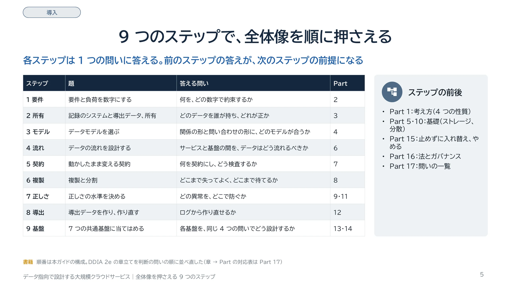
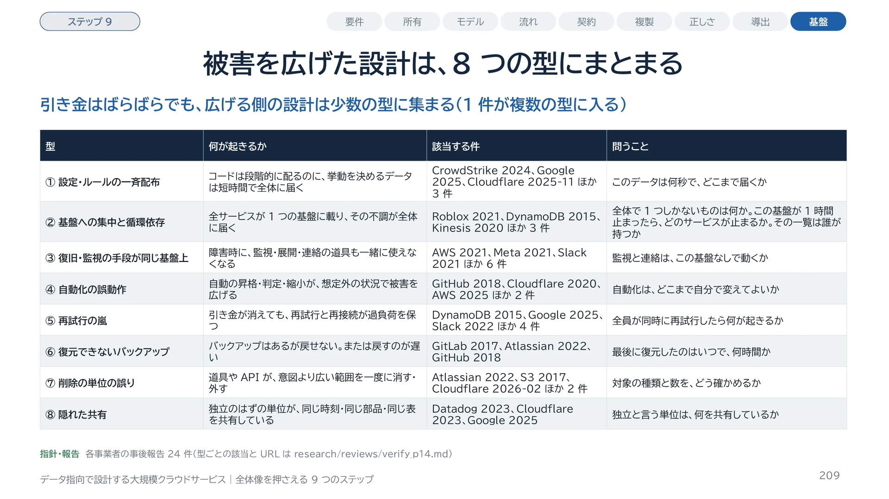
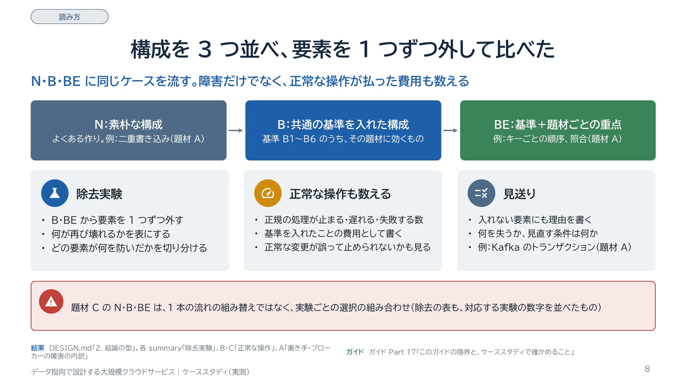
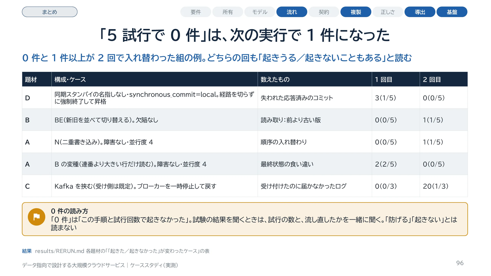

:::message
この記事は、生成AIを使って作成し、筆者が内容を確認・修正したうえで公開しています。
:::

スライド「データ指向で設計する大規模クラウドサービス ― 全体像を押さえる 9 つのステップ」(256 枚、発表者ノートつき)と、その対になるケーススタディ(106 枚)を公開しました。対象は、マイクロサービスと共通基盤から成るシステムの全体設計を任された、新任のテックリーダーです。RDB と Web アプリの開発経験はあるが、分散システムの理論は体系的に学んでいない人を想定し、用語は定義と図から説明しています。

ガイドは、設計で順に決めていく 9 つの問いと、設計レビューで問う観点をまとめたものです。ケーススタディは、ガイドが「実測する」と書いた点を、1 台の Docker 環境で確かめた記録です。同じ実験を最初から 2 回流し、2 回で違った結果は並べて書きました。

- ガイド(256 枚): [Web スライド](https://takenori-kusaka.github.io/data-intensive-design-guide/)、[GitHub リポジトリ](https://github.com/Takenori-Kusaka/data-intensive-design-guide)
- ケーススタディ(106 枚): [Web スライド](https://takenori-kusaka.github.io/data-intensive-design-casestudy/)、[GitHub リポジトリ](https://github.com/Takenori-Kusaka/data-intensive-design-casestudy)(実験の仕組みと結果)
- 設計レビューの一覧表(xlsx、161 行): [data-intensive-design-review.xlsx](https://github.com/Takenori-Kusaka/data-intensive-design-casestudy/blob/main/catalog/data-intensive-design-review.xlsx)

@[docswell](https://www.docswell.com/s/takenori_kusaka/ZX2J7G-2026-11-18-210106)

@[docswell](https://www.docswell.com/s/takenori_kusaka/5Y8XLE-2026-11-25-213232)

調査の時点は 2026 年 11 月です。ケーススタディの会社・サービス・数値はすべて架空で、実在の組織のシステムとは関係がありません。測ったのは 1 台の上の OSS だけで、クラウドのマネージド製品と、認証・AI・セキュリティの各基盤は測っていません。時間と容量の数字は、同じ環境の中の相対比較です。製品の優劣を示すものではありません。

## 1. 全体設計を任されたとき、何から見るか

想定した場面は次のとおりです。業務サービスが複数あり、その下にデータ・ETL・ログ・認証・AI・分析・セキュリティの 7 つの共通基盤があります。この全体を、柔軟性・拡張性・置換性・更新性を保って設計するように言われます。個々のデータベース製品の解説は多くありますが、全体をどの順番で見ればよいかは、別の問いです。

ガイドの出発点は、データはコードより長く残る、という見方です。サービスのコードは書き直され、データベースの製品も入れ替わります。その間も、注文の記録のようなデータは読まれ続けます。ガイドはこの点を、『ソフトウェアアーキテクチャ・ハードパーツ』1.3 節 p.4 と、『データ指向アプリケーションデザイン 第2版』2.5 節 p.50〜51 を根拠に挙げて説明しています。だから、コードの設計より先に、データの持ち方と流し方を決めます。

その順番を、ガイドは 9 つのステップにしました。各ステップは 1 つの問いに答え、前のステップの答えが次のステップの前提になります。

| ステップ | 答える問い | Part |
| --- | --- | --- |
| 1 要件 | 何を、どの数字で約束するか | 2 |
| 2 所有 | どのデータを誰が持ち、どれが正か | 3 |
| 3 モデル | 関係の形と問い合わせの形に、どのモデルが合うか | 4 |
| 4 流れ | サービスと基盤の間を、データはどう流れるべきか | 6 |
| 5 契約 | 何を契約にし、どう検査するか | 7 |
| 6 複製 | どこまで失ってよく、どこまで待てるか | 8 |
| 7 正しさ | どの異常を、どこで防ぐか | 9・11 |
| 8 導出 | ログから作り直せるか | 12 |
| 9 基盤 | 各基盤を、同じ 4 つの問いでどう設計するか | 13・14 |



この順番はガイドの構成で、本の章立てとは違います。「記録のシステム」は最初に書く場所で、「導出データ」はそこから作り直せるデータです。ステップ 2 で正を 1 つに決め、ステップ 4 以降で、導出データへどう流し、どう作り直すかを決めていきます。

## 2. ガイドが扱う範囲と、確かめ方

ガイドは 18 の Part に分かれます。9 つのステップの前後に、考え方、基礎、置換と更新、法とガバナンス、まとめがあります。

| Part | 題 | 位置づけ |
| --- | --- | --- |
| 0 | この資料の使い方 | 導入 |
| 1 | データ指向と 4 つの性質 | 考え方 |
| 2 | 要件と負荷を数字にする | ステップ 1 |
| 3 | 記録のシステムと導出データ、所有 | ステップ 2 |
| 4 | データモデルを選ぶ | ステップ 3 |
| 5 | ストレージと索引 | 基礎 |
| 6 | データの流れを設計する | ステップ 4 |
| 7 | 動かしたまま変える契約 | ステップ 5 |
| 8 | 複製と分割 | ステップ 6 |
| 9 | 正しさの水準を決める | ステップ 7 |
| 10 | 分散システムで信用できないもの | 基礎 |
| 11 | サービスをまたぐ整合性 | ステップ 7(続き) |
| 12 | 導出データを作り、作り直す | ステップ 8 |
| 13 | 7 つの共通基盤に当てはめる | ステップ 9 |
| 14 | 共通基盤が全体を止める 8 つの型 | ステップ 9(続き) |
| 15 | 止めずに入れ替え、やめる | 置換と更新 |
| 16 | 法・プライバシー・ガバナンスを設計に入れる | 責任 |
| 17 | 設計レビューで問うこと | まとめ |

### 2.1 根拠は 3 種類

各スライドの下の行に、根拠を 3 種類に分けて書いています。

- 仕様・文書:標準、製品の公式文書(版と確認月つき)、原論文
- 指針・報告:公的機関とクラウド各社の設計指針、事業者の事後報告
- 書籍:章・節・印刷ページ

指針は任意の推奨で、事後報告は事業者の自己申告です。一次資料で裏づけられない主張と、ガイドによる整理には「本ガイドの考え」の印を付けました。クラウドのマネージド製品の記述は公式文書によるもので、「未検証」と表示しています。

書籍は 4 冊を地図として使いました。『データ指向アプリケーションデザイン 第2版』が中心で、訳語もこの本に揃えています。ほかは『ソフトウェアアーキテクチャ・ハードパーツ』『大規模データ管理 第2版』『プラットフォームエンジニアリング』です。ガイドは本の要約ではありません。書名・章・節・ページと短い要約だけを引き、本文と図は転載していません。数字・既定値・事故の経緯は、公式文書と事後報告で確かめ直しました。

### 2.2 事後報告から読んだこと

Part 1 と Part 14 は、事業者自身が公開した事後報告を材料にしています。ガイドが選んだ 19 件(2015〜2025 年)を、報告が最初に挙げる出来事で 1 件 1 分類にすると、変更・操作が 13 件でした。境界の取り方で 12〜14 件の幅があります。機器・電源・ネットワークの障害や乱れは 3 件です。選定と分類はガイドによるもので、報告を公開する事業者に偏るので、業界全体の頻度ではありません。

Part 14 は、原文を開けた 24 件(2015〜2026 年、13 事業者)を、被害を広げた設計で 8 つの型に分けました。設定・ルールの一斉配布、基盤への集中と循環依存、復旧・監視の手段が同じ基盤上にあること、自動化の誤動作、再試行の嵐、復元できないバックアップ、削除の単位の誤り、隠れた共有の 8 つです。1 件は複数の型に入るので、型ごとの件数の合計に意味はありません。



全体が止まる条件としてガイドが挙げるのは、要求の経路にある同期の依存です。要求のたびに基盤へ問い合わせる利用側は、基盤と一緒に止まります。鍵・方針・設定を先に配っておき、手元の写しで判断する形なら、基盤が止まっても要求は通ります。失うのは鮮度です。

### 2.3 ガイドの確かめ方

確かめ方は 5 段です。

1. 各 Part の書き手が、載せる数字・版・既定値・日付・書籍のページを原典で確かめた
2. 全スライドの画像を 1 枚ずつ見て、配置を直した
3. 書き手とは別の 12 担当が、一次資料と照合した。観点は 3 つ(標準・論文／製品・事後報告／書籍・機関)。指摘は 188 件(誤り 1、不正確 65、補足 122。重大度は担当ごとの分類)
4. 指摘は、反映の担当が一次資料で確かめてから直し、全件を記録した
5. 公開の後、ケーススタディの「ガイドの記述との照合」152 行を 1 行ずつスライドと突き合わせ、注記と本文に反映した

5 段目では、48 枚のスライドが変わりました。この反映の差分も、反映した担当とは別の目で、ケーススタディの結果のファイルと突き合わせています。指摘は 27 件(高 0・中 6・低 21)で、26 件を直しました。残る 1 件は README と公開物の食い違いで、公開の作業で解くものでした。確かめ直しとファクトチェックは AI(Claude)による作業で、人が結果を確認しています。記録はガイドのリポジトリの `research/reviews/` にあります。

## 3. ケーススタディ:構成を 3 つ並べ、2 回流す

舞台は、1 つの架空の宅配注文サービスです。注文と在庫の業務サービスが記録のシステムを持ち、共通基盤(イベント基盤、検索・分析、ログ基盤)に導出データを作ります。この上で 4 つの題材を測りました。

| 題材 | 問い | 実行の数(1 回の通し) |
| --- | --- | --- |
| A 基盤をまたぐデータ統合 | 注文の状態の変化を、検索の索引と通知へ、失わず・重複させず・順序を崩さずに届けられるか | 179 |
| B 置換と更新の演習 | 動かしたまま、スキーマを変え、導出ストアを入れ替え、ログから作り直せるか | 258 |
| C 共通基盤の費用と性能 | ログ基盤・分析基盤で、どの持ち方が何を払うか | 522 |
| D 整合性の異常の再現 | どの設定が、どの異常を許し、何を失うか | 1,224 |

1 実行は、結果のファイル(JSONL)の 1 行です。4 題材を合わせて 2,183 実行で、これを同じコードで最初から 2 回流しました。実行 ID の集合は 2 回で同じです。ほかに、題材 A の追加実験 A-P1(CDC の読み取り間隔、25 実行)があります。これは 1 回だけ流したもので、2 回の比較には入っていません。

比べた構成は 3 つです。

- 素朴(N):よくある作り。題材 A なら二重書き込み
- 基準(B):共通の基準を入れた構成
- 基準＋重点(BE):B に、題材ごとの重点を足した構成

以下、N・B・BE は構成の名前で、題材の A・B・C・D は「題材 A」のように書き分けます。

共通の基準は 6 つで、ガイドの各 Part の主張をそのまま基準にしました。

1. 記録のシステムを 1 つに決め、ほかは導出データとして作る
2. 二重書き込みをしない
3. 受け手を冪等にする
4. スキーマの互換性検査を通してから配る
5. 応答済みの書き込みを失わない複製の設定にする
6. 導出データを作り直す手順と前提条件を持つ



測り方には、次の約束があります。

- 除去実験:B や BE から要素を 1 つずつ外し、何が再び壊れるかを表にする
- 正常な操作も数える:基準を入れたせいで正規の処理が止まる・遅れる・失敗する数を、基準の費用として書く
- 正解は生成器から作る:どの操作が成功と応答されたか、最終状態はどうあるべきかを、種を固定した生成器から決める。実験の出力から正解を作ると、壊れた結果を正解にしてしまう
- 最終状態で判定する:ログの文言ではなく、DB と導出ストアの最終状態を見る
- 判定器を監査する:誤りを仕込んだデータと誤りの無いデータを流す。監査は 189 ケースで、2 回とも全部が合格した
- 障害は件数を合図に入れる:切断・一時停止・強制終了を、決めた件数目で入れて外す

受け手の冪等性は、題材 A では次の形で入れています。イベントの ID を、効果と同じトランザクションで処理済みの表に入れ、既にある ID のイベントは飛ばします。

```python
# https://github.com/Takenori-Kusaka/data-intensive-design-casestudy/blob/9a7becae28f06cc72fd751f30daf28a87d4dc282/cs/a/consumer.py
            with conn.transaction():
                fresh = True
                if idem:
                    fresh = conn.execute('insert into processed (role, event_id) values (%s, %s) '
                                         'on conflict do nothing', (role, eid)).rowcount == 1
                if fresh and role == 'index':
                    conn.execute('insert into orders_index (order_id, status, last_event, update_count) '
                                 'values (%s, %s, %s, 1) on conflict (order_id) do update set '
                                 'status = excluded.status, last_event = excluded.last_event, '
                                 'update_count = orders_index.update_count + 1',
                                 (ev['order_id'], ev['status'], eid))
                    # ...
```

実行した環境は 1 台です。AMD Ryzen 7 3700X(論理 CPU 8)、WSL2 の Ubuntu 24.04.2 LTS、Docker Engine 29.9.2 です。製品の版は次のとおりです。

- データベース:PostgreSQL 18.7、MySQL 8.4.13、CockroachDB v26.4.0
- イベント基盤:Redpanda v26.2.7、Apache Kafka 4.4.0、Debezium 3.7
- 分析とログ:ClickHouse 26.8、DuckDB 2.0.0、OpenTelemetry Collector 0.165.0

## 4. 題材ごとの結果

数は、断りが無ければ 2 回とも同じ値です。2 回で違った数は「1 回目・2 回目」の順に並べます。「0 件」は、この手順と試行の数で起きなかったという意味で、起きないことの証明ではありません。件数の後ろの「(4/5 試行)」は、5 試行のうち 4 試行で 1 件以上起きたことを表します。

### 4.1 題材 A:基盤をまたぐデータ統合

注文の更新 2000 件(注文 200 件)を、3 つの構成で索引と通知へ届けました。N は二重書き込みで、DB をコミットしてから続けてブローカーへ発行します。B はアウトボックスとポーリング(間隔 50 ms)、BE はアウトボックスと CDC(Debezium)です。アウトボックスは、同じトランザクションで送信用の表に書き、別のプロセスがそれを運ぶ方式です。

- 二重書き込みは、障害を入れなくても順序が入れ替わりました。並行度 16 で 5 組(4/5 試行)・11 組(5/5 試行)、並行度 4 で 0 組・1 組(1/5 試行)です。エラーは返っていません。最終状態の食い違いは、Redpanda では 2 回とも 0 注文でした。入れ替わりが、その注文の最後の 2 件に当たったときだけ食い違いとして残るので、残るかどうかは試行によります。
- 二重書き込みで書き手を強制終了すると、DB にコミット済みなのに索引に届かないイベントが 14 件・16 件ありました。アウトボックスの 2 つの構成では 0 件です(各 3 試行)。
- 重複は、どの構成でも届きました。冪等な受け手つきのアウトボックスの 2 構成(変種と除去の実行を除く 77 実行)で、届いた重複は 1551 回・1746 回、受け手の状態に 2 回効いたイベントは 0 でした。Kafka のトランザクションは使っておらず、それを使った構成は未検証です。
- 受け手から冪等性を外すと、届いた重複がそのまま通知の重複になりました。受け手の強制終了のケースでは、届いた重複 45 回がすべて通知に 2 回効いています。
- BE からキーごとの順序を外し、メッセージのキーを注文 ID からイベント ID に変えると、欠落と重複は 0 件のまま、順序だけが崩れました。障害なし・並行度 16 で、入れ替わりは 1176 組・1172 組(5/5 試行)です。エラーは出ません。
- 「最後に読んだ連番より大きい行だけ読む」ポーリングの変種は、応答済みのイベントを読み飛ばしました。障害なしの並行度 16 で 76 件・85 件(どちらも 5/5 試行)、並行度 4 で 12 件(5/5 試行)・1 件(1/5 試行)です。「未送信の行」を読む B は、同じ条件で 0 件でした(各 5 試行)。
- Debezium を止めたまま書き続けると、既定(上限なし)ではスロットが保持する WAL が 271.7 MB・271.6 MB まで増え続けました。上限(64MB)を付けるとスロットは無効になり、止めている間に書いた 800 件(試行ごと、2 試行)が届きませんでした。そのとき、コネクタのタスクの状態は RUNNING のままで、失敗の内容も記録されていません。
- スロットを作り直して取り直すと、届かないイベントは 0 件に戻りました。ただし、索引には一部の注文で食い違いが残りました。原因は調べていません。照合で直した後の差は 0 です。

基準の費用は遅れに出ました。並行度 1 の遅れの p50 は、N が 10.8 ms、B が 19.4 ms・17.2 ms、BE が 691.2 ms・699.6 ms です。BE のコネクタの読み取りの間隔は指定していません。この点は 6 章で扱います。

### 4.2 題材 B:置換と更新の演習

7 つの実験で、イベントと DB のスキーマ変更、導出ストアの入れ替え、ログからの作り直し、記録のシステムの入れ替えを測りました。

スキーマの互換性検査は、Redpanda の内蔵のレジストリで測りました。何も設定しないレジストリの既定は BACKWARD と表示されました。

- v1 → v2 → v3 と、段ごとには検査を通る変更の列を登録し、最新の版の受け手がトピックを先頭から読み直しました。既定は、Avro・Protocol Buffers・JSON Schema の 3 形式とも v3 を通し、v1 のデータ 100 件が読めないか、誤った値になりました。BACKWARD_TRANSITIVE は v3 の登録を拒否しました。末尾だけ読む受け手は、どの構成でも全件を正しく読めています。問題は、先頭から読み直すまで表に出ません。
- Protocol Buffers では、最も厳しい FULL_TRANSITIVE でも登録を通り、エラーも出ない変更が 3 件ありました。どれも、受け手の値を誤らせるか、欠けさせます。受け手が使うフィールドの削除、型を狭める変更(int64 → int32)、消した番号の再利用です。受け手が使うフィールドを消した場合は、旧い受け手で 100 件中 100 件の値が欠けました。受け手は Python の実装だけで、ほかの言語の実装は未検証です。

DB のスキーマ変更は PostgreSQL 18 で測りました。

- 住所の列を 2 列に分ける変更を 1 つのトランザクションで行うと、失敗した要求が 195 件・189 件(5/5 試行)出ました。expand/contract(広げる、移す、縮めるの 3 段階)では 0 件(5 試行)です。代わりに所要時間は、2.7 秒に対し 6.4 秒・6.2 秒に延びました。DDL は 3 回、アプリの配り直しも 3 回要ります。
- 表を読んだトランザクションを 6 秒開いたまま、数 ms で済む列の追加をすると、読み書きが約 5.5 秒止まりました。待っている DDL の後ろに、ほかの読み書きが並んだためです。lock_timeout 200 ms と再試行を付けると、失敗した要求は 0 件でした。DDL は 9 回目で成功し、終わるまでの時間は短くなっていません。

導出ストアの入れ替えと作り直しです。

- 索引を同じ場所で一括して作り直すと、「見つからない」読み取りが 1222 件・1296 件(5/5 試行)出ました。新旧を並べて作り、照合してから少しずつ切り替えると 0 件です。ただし、切り替えの途中に前より古い版を読んだ読み取りが、0 件(0/5 試行)・1 件(1/5 試行)ありました。この行の判定は「実行によって変わった」で、原因は調べていません。
- 照合を外すと、欠陥のある受け手で作った新のストアへ、5/5 試行で切り替わりました。照合ありでは 5/5 試行で止めています。
- ログからの作り直しは、保持の範囲を前提にします。保持を 5 秒に縮めた条件で、ログだけから作り直すと、無い注文が 300(3/3 試行)出ました。スナップショットと、記録した位置からのログで作り直すと 0 です。既定の 7 日を実際に待った場合は未検証です。

記録のシステムの入れ替えは、同じ版の PostgreSQL 18 の別のインスタンスへ移す形で測りました。

- アプリの二重書き込みで移すと、移し切った後に、応答済みの書き込みの欠落が 13 件・11 件(5/5 試行)残りました。論理レプリケーション、照合、遮断、逆向きの複製を組み合わせた BE では 0 件です。BE の費用は、遮断した旧へ書こうとして失敗した書き込み 186 件(5/5 試行)と、切り替えで書き込みが止まった時間(259 ms・258 ms。遮断しない切り替えは 68 ms・79 ms)でした。
- 二重書き込みの構成で、埋め戻しを「版を比べ、古ければ捨てる」形に変えても、新の側で古いか無い行が残りました(1 試行あたり 3.2 件・4.8 件。上書きの埋め戻しは 5.8 件・5.0 件)。減ったとは言えません。原因は調べていません。

別の製品への移行と、マネージド製品の移行の道具は未検証です。

### 4.3 題材 C:共通基盤の費用と性能

同じ注文のログを、行指向(PostgreSQL)、列指向(ClickHouse)、ファイル(DuckDB＋Parquet)の 3 つの持ち方に入れて比べました。どの規模もメモリに収まる大きさです。

- 3,000,000 行の容量は、PostgreSQL 718.4 MB、ClickHouse 220.1 MB、DuckDB＋Parquet 169.7 MB でした。キーで 1 行の検索は行指向が短く、店舗ごとの集計は列指向とファイルが短い結果です(大小は 2 回とも同じ)。差は、持ち方と索引の組み合わせで出ています。データは生成器が作った一様に近い分布で、圧縮の効き方はデータに左右されます。
- スキーマが揺れたとき、製品の既定のまま型つきで取り込む作りは、7 ケースのうち 4 ケースで、結果が製品の間で違いました。たとえばフィールドが消えると、ある作りは取り込みが止まり、ある作りは黙って 0 で埋め、ある作りは読めました。「止まる」は、揺れていない行も入らないことです。動きは、製品と取り込みの作りの組み合わせで決まっています。
- 揺れた行を保留の表に回す BE の作りは、取り込みを止めず、揺れていない行の被害を 0 行にしました。費用は、値としては読める数字の文字列も保留に回したことです。保留を見る人と手順が要ります。
- 同じ範囲のバッチをもう一度流す実験では、同じ入力・訂正後の入力・半分で止まるの 3 つの場面とも誤りが 0 件だったのは、範囲を消して入れ直す作りでした。UPSERT は、訂正で入力から消えた行を表に残しました(余分 100 行)。
- 古い 10 日分を落とす実験では、PostgreSQL の DELETE と ClickHouse の軽量な削除は、直後に容量が減りませんでした。パーティションの単位で DROP する落とし方は、時間が短く、直後に容量が減りました。
- PostgreSQL に索引を 1 本足すと、顧客 1 人の絞り込みは 42.5 ms・49.0 ms から 0.45 ms・0.56 ms になり、一括の取り込みは 1.59 倍・1.60 倍になりました。一方、ClickHouse のスキップ索引と DuckDB の索引の効果は、問い合わせの形で向きが違いました。試行の範囲が重なるものは、差を言えません。

テレメトリの送信は、OpenTelemetry Collector で測りました。受け付け済み(HTTP 200)なのに下流に届かなかったログを数えています。

- メモリのキュー(既定)は、下流の停止中に Collector を強制終了すると失いました(2,000 件中、800〜820 件・800 件)。ディスクのキューでは 0 件です(各 3 試行)。
- 下流の停止が再試行の上限より長いと、メモリのキューでもディスクのキューでも失いました。再試行の上限は 3 秒に縮めて測っています。
- Kafka を間に置いても、読む側の Collector が既定のままだと、下流の停止中の強制終了で 820 件を失いました。先に読み出して、自分のメモリに持っていたためです。処理の後で印を付ける設定では 0 件でした(各 3 試行)。この実験の Kafka の役は Redpanda の 1 ノードで、Apache Kafka では流していません。
- ブローカーを一時停止して戻しただけの場面の結果は、2 回で違いました。1 回目は失っていません(0/3 試行)。2 回目は 1/3 試行で 20 件を失いました。原因は特定していません。

### 4.4 題材 D:整合性の異常の再現

分離レベルごとの異常は、Hermitage の考え方で、文の実行順を固定して測りました。PostgreSQL・MySQL・CockroachDB の結果は、Hermitage の README の表(100 セル)と食い違いませんでした。同じ名前の水準でも、許した異常は製品で違います。

- 在庫を読み、1 を引いて書き戻す並行の負荷で、MySQL 8.4 の Repeatable Read(既定)は、ロストアップデートを 2449 件・2417 件起こしました(応答済み 6000 件、15 試行の合計)。エラーは返りません。PostgreSQL の同じ名前の水準は 0 件(15 試行)で、代わりに直列化の失敗(40001)を返し、再試行を求めます。PostgreSQL の既定の Read Committed でも、ロストアップデートはエラーなしに起きています。
- 防ぐ手段(条件つきの UPDATE、SELECT FOR UPDATE、バージョン列、Repeatable Read や Serializable と再試行)は、どれも消えた更新が 0 件でした(並行度 16、5 試行)。費用の出方は違います。再試行しない Serializable は、正常な要求を 261 件・267 件失敗させました。
- ライトスキューは、PostgreSQL の Repeatable Read でも起きました。Serializable と再試行か、前提にした行のロックで 0 件です(各 15 試行)。

複製は PostgreSQL のプライマリとスタンバイで測りました。

- synchronous_commit = on でも、同期スタンバイを名指ししないと(synchronous_standby_names が空)、経路を切った後に応答した 600 件(3 試行の合計)を昇格で失いました。名指しすると 0 件(3 試行)です。
- 名指しした構成で同期スタンバイを止めると、書き込みは観測の時間(15・60 秒)の間は返りませんでした(12/12 試行)。損失ゼロの設定は、別の止まり方を持ち込みます。
- 経路を切らずに強制終了すると、失う件数は強制終了の瞬間で変わりました。名指しなし・on は 2 回とも 0 件(5 試行)、名指しなし・local は 3 件(1/5 試行)・0 件(0/5 試行)です。この 0 件は「この試行では届いていた」という意味で、失わない設定という意味ではありません。
- 非同期の複製で、旧プライマリを遮断せずに昇格すると、旧プライマリが昇格後も 300 件に応答しました(3 試行の合計)。同じ ID で中身の違う行が 204 件できています。昇格の前に旧プライマリを止めると、どちらも 0 件でした(3 試行)。遮断は旧プライマリの停止だけで、ネットワークとストレージの遮断は測っていません。

## 5. 2 回流して分かったこと

2 回の実行を、同じ実行 ID どうしで比べました。欄は 3 つに分けています。時間と大きさ、並行の競合や時間に頼る数、それ以外の決定的な欄です。

決定的な欄が変わった実行は、題材 D・A・B では 0 でした。題材 C では 16 実行で変わり、すべて Collector の送信の実験(C-6)です。障害は件数を合図に入れましたが、その後の結果は、キューが空く速さ、再試行の時刻、強制終了の瞬間に持っていた分に頼ります。決定的だと考えていた欄が、そうではないと分かりました。

次に、構成・ケース・数えたものの組ごとに、合計が 0 か 1 以上かを比べました。「起きた／起きなかった」が 2 回で変わった組は、4 題材で 21 ありました(題材 A 18、B 1、C 1、D 1)。



たとえば、新旧を並べて切り替える構成の「前より古い版の読み取り」は、1 回目 0 件(0/5 試行)、2 回目 1 件(1/5 試行)でした。1 回しか流していなければ、「5 試行で 0 件だった」とだけ書いていたはずです。

そこで、この記事とスライドでは「0 件」を次のように読みます。

- 「0 件」は、この手順と試行の数で起きなかったという意味。「防げる」「起きない」とは読まない
- 0 と 1 以上が 2 回で入れ替わった組は、どちらの回も「この条件で起きうるが、起きない試行もある」と読む
- 並行の競合や、強制終了の瞬間に頼る数は、試行が多くは 3〜5 回と少ない。試験の結果を聞くときは、試行の数と、流し直したかを一緒に聞く

時間も揺れました。題材 A の遅れの p50 は、同じ実行 ID どうしの比(2 回目 ÷ 1 回目)が、中央 0.94、最大 68.95 です。時間は、同じ環境の中の相対比較にとどめます。

## 6. 実測でガイドに条件を足した点

4 つの題材の「ガイドの記述との照合」の表は、合わせて 152 行です(A 16、B 53、C 42、D 41)。無条件の「食い違い」と判定した行はありません。条件の付いた行と、2 回で判定の変わった行があり、ガイドの注記と本文に戻しました。主なものは次のとおりです。

| ガイドの記述 | 判定 | 実測が足した条件 |
| --- | --- | --- |
| CDC は書き込みの直後に流せる(中継が健全である間) | 条件つきで食い違い | 読み取りの間隔を指定しない CDC の遅れの p50 は 691.2 ms・699.6 ms で、間隔 50 ms のポーリング(19.4 ms・17.2 ms)より長かった |
| 連番の順に読むポーリングは読み飛ばすか(一次資料では確かめられなかった) | 未確認だった点の実測 | 「最後に読んだ連番より大きい行だけ読む」作りは読み飛ばした。「未送信の行を読む」作りは 0 件(各 5 試行) |
| Protocol Buffers:削除も安全 | 条件つき | 受け手が使うフィールドを消すと、全モードで登録が通り、エラーも無く、値が欠けた |
| 並べて切り替えれば、どの段階でも旧に戻せる | 実行によって変わった | 切り替えの途中に前より古い版の読み取りが、0 件・1 件(1/5 試行) |
| 埋め戻しは、版を比べ、古ければ捨てる | 一部だけ再現 | 版を比べても、古い・無い行が残った。減ったとは言えない |
| Kafka を間に置くと、下流が戻るまで Kafka にたまる | 条件つき | 読む側の Collector が既定のままだと、強制終了で失った |
| 1 つの RDB で兼ねてよい規模の境目は実測で示す | 一部だけ実測 | 集計を 4 本並べた 100 万行・300 万行でだけ、検索の p95 が 1.5 倍を超えた。境目の線は、この規模では引けていない |

CDC の遅れは、追加実験 A-P1 で確かめ直しました。この実験は 1 回だけ流したもので、2 回の比較はありません。Debezium の poll.interval.ms を 100・50・10 ms に縮めると、CDC の p50(5 試行の中央値)は 149.3・76.0・24.8 ms に縮みました。指定なしは 703.1 ms です。10 ms でも、同じ回のポーリング(18.0 ms)より長く、大小は入れ替わりませんでした。10 ms より縮めた条件と、ほかの設定の効き方は調べていません。ガイドの表は「遅れは、コネクタの読み取り間隔の設定で変わる」と書き足しています。

ガイドの側で「一次資料では確かめられなかった」と書いていた点を測った行は、「一次資料では確かめられなかったが、ケーススタディで実測した」の形に改めました。一次資料で確かめたわけではないので、「確認した」とは書いていません。実測は 1 台・小さな規模・少ない試行のもので、ガイドの主張を実測より強くしてはいません。

## 7. 設計レビューの一覧表(xlsx)

ケーススタディのリポジトリに、[設計レビューの問いの一覧](https://github.com/Takenori-Kusaka/data-intensive-design-casestudy/blob/main/catalog/data-intensive-design-review.xlsx)を置きました。ガイドとケーススタディに「設計レビューで問うこと」として書いてある問いを、1 行 1 問で並べた 161 行の表です。内訳は、ガイドの問いが 151 行、ケーススタディだけの問いが 10 行です。問いは、ガイドとケーススタディに書いてあるものだけで、設計レビューで問うべきことの網羅ではありません。

列は 40 あり、次のまとまりに分かれます。

- 定義(11 列):No、ID、ステップ、対象、問い、なぜ問うか、よい答えの例、危ない兆候、いつ問うか、まず問う問いか(Part 17)、4 つの性質のどれに効くか
- 記入欄(5 列):自分のシステムでの現状の答え、判定、担当、期限、メモ。判定は、問題なし・要対応・対象外から選びます。空のまま配っています
- ガイドが名指しした基盤(8 列):データ・ETL・ログ・認証・AI・分析・セキュリティの各基盤に ○ か —。右隣に、名指しの根拠のスライド
- 根拠(4 列):根拠の種別、根拠、書籍、ガイドのスライド
- 実測(6 列):題材と実験、実測の結果、実測の判定(区分)、実測の判定(照合の表のまま)、結果へのリンク、ケーススタディのスライド
- 架空の宅配注文サービスでの扱い(4 列):扱いの判定、理由、正常な操作への費用、見直し条件
- 備考(2 列):備考、出どころの種別

設計レビューでの使い方は次のとおりです。まず「使い方」と「凡例」のシートで、列と値の意味を確かめます。次に「一覧」を、ステップで絞り込みます。初めてなら「まず問う問いか」の列を「はい」で絞ります。Part 17 が、ステップごとに最初に問うと選んだ問いです。基盤を 1 つ見るときは、2 回に分けて読みます。1 回目は、その基盤の列を「○」で絞ります。2 回目は、絞り込みを外し、「対象」を「共通基盤全般」で絞ります。どの基盤にも向ける問いで、27 行あります。○ は、ガイドがその基盤の名前を挙げて同じ点を書いている 28 行だけに付けました。○ が無いことは、その基盤に関係が無いという意味ではありません。レビューの場では、問いを読み上げ、返ってきた答えを「危ない兆候」「よい答えの例」と比べます。答えと判定、担当、期限は、黄色の記入欄に書きます。

実測の判定の列にある「照合の行なし(実測していない)」は、その問いに結びつく実測が無いという意味です。161 行のうち 95 行がこれに当たります。照合の行と結びついているのは 66 行です。「未検証」は別の値で、照合の行はあるが、結果の要約が測っていないとしたものです。

「扱い」の判定は、架空の宅配注文サービスに対するもので、自分のシステムへの推奨ではありません。列の設計と中身は、作成とは別の担当が点検し、指摘を反映しました。「集計」のシートは数式で数えるので、GitHub のプレビューでは空に見えます。Excel で開くと出ます。

## 8. 限界

- 1 台(8 コア、WSL2 の Docker)の上の、1 ノードの製品と小さなデータです。複製をまたぐ障害、リージョンをまたぐ障害、時計のずれに由来する異常、メモリに収まらない規模は測っていません。
- クラウドのマネージド製品は測っていません。ガイドの該当の記述は公式文書によるもので、未検証と明記しています。認証・AI・セキュリティの各基盤は組んでいません。
- 並行の競合に頼る数は、多くが 3〜5 回の試行です。0 件と 1 件以上が 2 回の実行で入れ替わった組があります。
- 保持の時間は縮めて測りました。Kafka の保持の 7 日を 5 秒に、削除の印の 1 日を 3 秒にしています。Collector の再試行の 5 分も待っていません。
- 電源断に当たる障害(ホストごと落とす)と、ディスクが埋まるまでの挙動は試していません。
- 原因を調べていない結果があります。スロットを作り直した後に残る索引の食い違い、版を比べる埋め戻しでも残る行、ブローカーを戻しただけで失った 20 件などです。ケーススタディのまとめのスライドは、こうした点を 13 挙げています。
- 事後報告は事業者の自己申告で、件数の分類と型への割り当てはガイドによります。
- 規格の本文(ISO/IEC 25010:2023、JIS X 25010:2025 など)は確かめていません。ガイドは定義文を引用せず、特性の名前の対応だけを使いました。
- 法に関わる記述は、設計の段階で決めておく点を示すもので、法的な助言ではありません。
- 製品の版・既定値・日付は、2026 年 11 月の調査時点のものです。

## 9. 持ち帰るもの

ケーススタディのまとめは、実測から言えることだけを 8 つの問いにしています。DB と別のシステムの両方に書く箇所はあるか。受け手は冪等か。CDC のスロットに上限と監視はあるか。互換性検査は、すべての版と比べているか。DDL に lock_timeout と再試行を付けているか。取り込みは、スキーマが揺れたときの動きを決めているか。読んで書き戻す箇所を何で守るか。同期スタンバイを名指ししているか、止まったときの手順はあるか。

持ち帰るのは「この条件で、これが起きた／起きなかった」という文です。数字は、この環境とこの手順での値で、自分のシステムの数字ではありません。使う前に、自分の版と設定で確かめてください。

詳しい条件と出典は、[ガイドのスライド](https://takenori-kusaka.github.io/data-intensive-design-guide/)の各ページと `research/reviews/`、[ケーススタディのスライド](https://takenori-kusaka.github.io/data-intensive-design-casestudy/)、[ケーススタディのリポジトリ](https://github.com/Takenori-Kusaka/data-intensive-design-casestudy)の README と `results/` の題材ごとの summary、2 回の比較の `results/RERUN.md` にあります。
