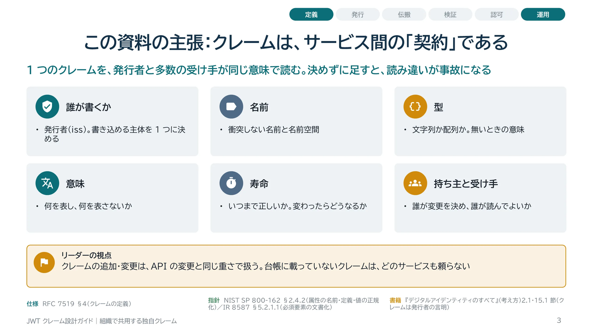
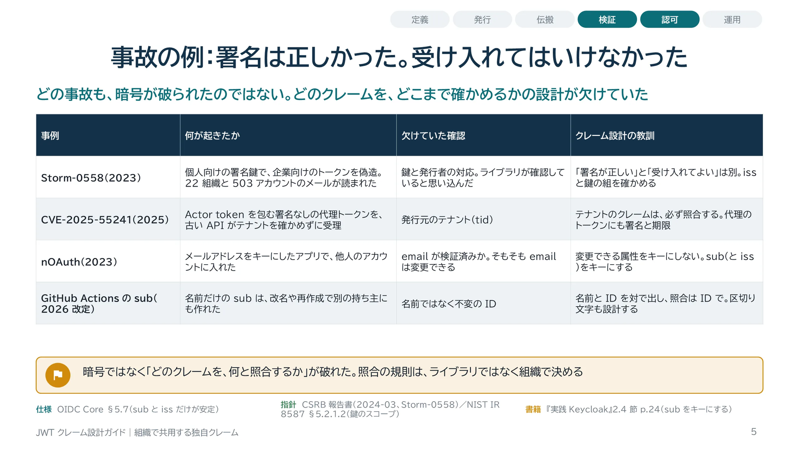
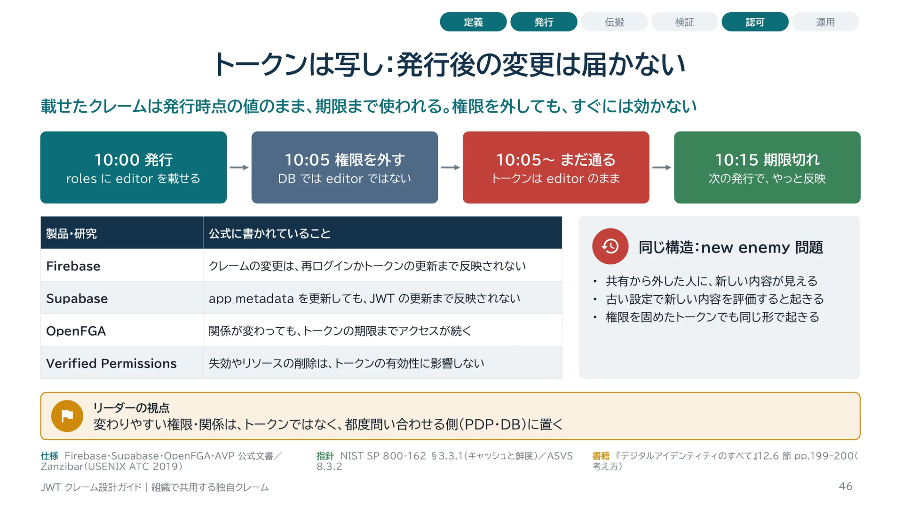
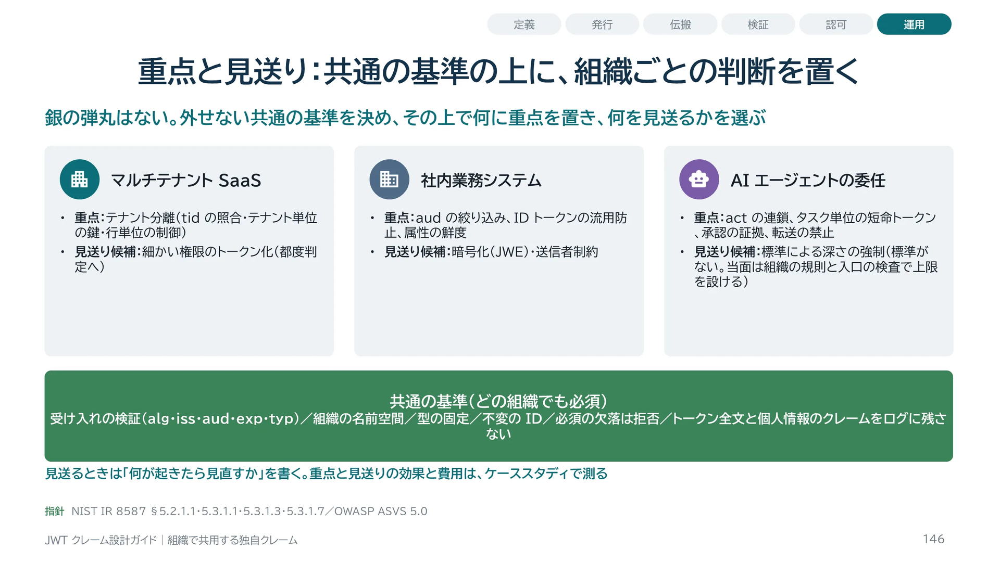

:::message
この記事は、生成AIを使って作成し、筆者が内容を確認・修正したうえで公開しています。
:::

スライド「JWT クレーム設計ガイド」(152 枚、解説ノートつき)と、その対になるケーススタディを公開しました。ガイドの主題は、組織のあらゆるサービスで共用する JWT の独自クレームの設計・伝搬・検証・ガバナンスです。OpenID Connect や OAuth の標準クレームそのものは、主題ではありません。対象は、認証認可とマイクロサービスの設計を任された新任のテックリーダーです。

ガイドは「何に重点を置き、何を見送るかは、ケーススタディで測る」と約束して終わります。ケーススタディは、その約束を果たすための実測です。どの組織でも外せない共通の基準が何を防ぎ、題材ごとの重点が何を足し、見送りが何を残すかを、攻撃と正規の要求で測りました。

- ガイド(152 枚): [Web スライド](https://takenori-kusaka.github.io/jwt-claims-guide/)、[GitHub リポジトリ](https://github.com/Takenori-Kusaka/jwt-claims-guide)
- ケーススタディ(49 枚): [Web スライド](https://takenori-kusaka.github.io/jwt-claims-casestudy/)、[GitHub リポジトリ](https://github.com/Takenori-Kusaka/jwt-claims-casestudy)(実験基盤と結果)
- 付録 JWT クレーム一覧(xlsx、805 行): [jwt-claims-catalog.xlsx](https://github.com/Takenori-Kusaka/jwt-claims-casestudy/blob/main/catalog/jwt-claims-catalog.xlsx)

@[docswell](https://www.docswell.com/s/takenori_kusaka/ZWR7NJ-jwt-claims-guide)

@[docswell](https://www.docswell.com/s/takenori_kusaka/KJWMVQ-jwt-claims-casestudy)

ガイドの調査基準日は 2026-11-17 です。各スライドの下に、仕様、公的な指針、日本語の書籍の 3 種類の根拠を示しています。全スライドは、作成とは別の担当が一次資料に当たって事実を点検し、指摘を反映しました。ケーススタディのスライドも、作成とは別の担当が事実を点検し、指摘を反映しました。測定の数値の正本は、リポジトリの結果の要約(`results/summary.md`)です。

## 1. クレームは、1 つの発行者と多数の受け手の契約

JWT のクレームは、発行者が「この主体について、これが正しい」と述べた言明です。組織で共用する独自クレームは、1 つの発行者が書き、多数のサービスが読みます。受け手は API サーバ、ゲートウェイ、サービスメッシュ、データベースの行単位の制御、バッチ、AIエージェントのツールと増えていきます。受け手ごとに、言語とライブラリが違います。配列のクレームを、ある受け手は配列として、別の受け手は空白区切りの文字列として読むかもしれません。

だからガイドは、クレームをサービス間の契約として扱います。誰が書くか、名前、型、何を意味し何を意味しないか、いつまで正しいか、誰が持ち主で誰が読んでよいか。この 6 つを決めずに足すと、受け手ごとに解釈がずれ、そのずれが権限の取り違えや情報の漏えいになります。



ガイドの冒頭で取り上げた 4 つの事故は、どれも暗号が破られたのではありません。どのクレームを何と照合するかの設計が欠けていました。

- Storm-0558(2023):個人向けアカウントの署名鍵で企業向けのトークンが偽造され、22 の組織と個人 503 のアカウントのメールが読まれました。SDK が鍵と発行者の対応を検証しておらず、アプリの開発者はライブラリが検証していると思い込んでいました([CSRB 報告書](https://www.cisa.gov/resources-tools/resources/CSRB-Review-Summer-2023-MEO-Intrusion))。
- CVE-2025-55241(2025):Actor token は、Entra ID のサービス間で使われるトークンで、Microsoft が署名しています。この Actor token を包んだ、署名のない代理用のトークンを、古い API が受け入れていました。欠けていたのは、発行元のテナント(tid のクレーム)の照合です。
- nOAuth(2023):変更できるメールアドレスのクレームを利用者のキーにしていたアプリで、他人のアカウントに入れました。
- GitHub Actions の sub:名前だけで作った sub は、リポジトリの改名や再作成で別の持ち主にも作れました。2026-07-15 以降に作成、改名、移譲したリポジトリでは、数値の ID を含む形になりました。既存のリポジトリは選択して切り替えます。



## 2. ガイドが扱う範囲

導入のあと、12 の Part に分かれます。前半は独自クレームを作る前に知っておく地図、後半は設計と流れ、最後が守りと統治です。Part 10 の act は、RFC 8693 のトークン交換で委任したときに、実際に行動している者を入れるクレームです。入れ子にでき、いちばん外側が今の行為者です。

| Part | 内容 |
| --- | --- |
| 1 | JWT の構造、検証の順序、危険なヘッダー、ID トークンとアクセストークン、ライブラリの既定値 |
| 2 | 既存のクレームの地図:16 の用途ごとの標準クレームと、独自クレームが要る隙間、SAML の属性 |
| 3 | 4 つの IdP(Microsoft Entra ID・Keycloak・Auth0/Okta・Amazon Cognito)の利用者キー・テナント・aud・ロールの位置・独自クレームの規則 |
| 4 | 設計原則:載せるか問い合わせるか、名前空間、型、不変の ID、書き手、サイズ、前方互換 |
| 5 | 権限の表現:利用者・ワークロード・システム、RBAC/ABAC/関係ベース、マルチテナント、BOLA(オブジェクト単位の認可の不備) |
| 6 | 流れ:発行時フック、入口での交換、Transaction Tokens(入口で発行した短命のトークンで、呼び出しの連鎖全体の文脈を運ぶ草案)、ヘッダー、証跡 |
| 7 | データ層:行単位の制御、DB の文脈と信頼境界、接続プール、トークンでの DB 認証、マスキング |
| 8 | 有効期限・リフレッシュ・失効・非同期処理 |
| 9 | 機微情報・最小化・ログ |
| 10 | AIエージェントのアクセスポリシー:委任(act)、ツールごとのスコープ、承認の証拠、MCP の認可 |
| 11 | ガバナンス:クレームの台帳、スキーマと契約テスト、変更の手順、追加前の 25 の質問 |
| 12 | 実践:アンチパターン、レビューの観点、重点と見送り、主張と根拠の対応、参考文献 |

設計の出発点は、トークンが発行時点の写しだということです。10 時に editor のロールを載せたトークンを発行し、10 時 5 分に権限を外しても、トークンの期限が切れるまでは editor のまま通ります。実装の不具合ではなく、自己完結型のトークンの性質です。そこでガイドは、載せる前に 4 つを問います。認可に使うのか。寿命の間に変わらないのか。小さく収まるのか。受け手の全員が要るのか。4 つとも当てはまるものだけを載せ、変わりやすい権限や関係は都度問い合わせる側に置きます。



受け手の側では、署名、発行者、宛先、期限、種類を確かめてからクレームを読みます。この確認は各サービスに任せず、共通の検証部品にします。根拠は RFC 7519・8725・9068 などの仕様([RFC 8725](https://www.rfc-editor.org/rfc/rfc8725))、NIST IR 8587・SP 800-63C-4・SP 800-162 や OWASP ASVS 5.0 などの公的な指針、日本語の書籍 4 冊です。

最後の Part は、銀の弾丸はないという立場から、判断を 2 段に分けます。1 段目は、どの組織でも外せない共通の基準です。受け入れの検証(alg・iss・aud・exp・typ)、組織の名前空間、型の固定、不変の ID、必須の欠落の拒否、ログの扱いの 6 つです。ログには、トークン全文と個人情報のクレームを残しません。2 段目は、何へ重点を置き、何を見送るかという、組織ごとの判断です。重点は題材ごとに足す対策で、見送りは効果があっても今は採らない対策です。見送るときは、何が起きたら見直すかを書きます。



## 3. ケーススタディ:基準・重点・見送りを攻撃で測る

ケーススタディは、ガイドの重点と見送りを実際に測る実験基盤です。LLM は使わず、同じ手順で何度でも同じ判定になります。時刻は仮想の時計で進め、試算は乱数の種を固定しました。IdP の実際の挙動を見るために Keycloak 26.8 をコンテナで動かし、行単位の制御は Postgres 16 の RLS(Row Level Security)で確かめます。Entra ID・Okta・Cognito・Auth0 は、2026 年 11 月時点の公式文書にある形を再現した模擬です。

構成は、検証や対策の要素の集合です。比べた構成は 3 つです。

- N:要素なし。よくある誤りの再現です
- B:共通の基準の 9 要素
- BE:B に、題材ごとの重点の要素を足したもの

B の 9 要素は、ガイドの共通の基準のうち、受け入れの検証を 5 つに分けたものです。ログの扱いは、このケーススタディでは測っていません。

1. alg:alg の許可リスト(RS256)。jku・jwk・x5u・x5c を無視し、kid は登録済みの鍵だけ
2. iss:iss を許可リストと完全一致。鍵はその発行者に登録されたものだけ
3. aud:aud に自分が含まれるか
4. exp:exp を必須にし、ずれは 30 秒まで
5. typ:typ(Cognito は token_use)でアクセストークンだけを受ける
6. required:組織で必須と定めたクレームが無ければ拒否
7. types:必須クレームの型を確認(ID は文字列、配列は配列)
8. immutable_id:利用者のキーは sub・oid+tid・uid。ログイン名やメールを使わない
9. namespace:組織のクレームは組織の名前空間の中だけを読む

exp の無いトークンは期限のない合鍵になるので、exp は無ければ拒否します。組織で必須と定めたクレームが欠けたトークンも、既定値で処理させずに拒否します(fail closed)。重点は題材ごとに 4〜5 要素あります。たとえばマルチテナント SaaS では、テナントと発行者の照合、すべての SQL へのテナント条件、SET LOCAL と RLS、テナント単位の鍵の 4 つです。

共通の基準の検証部品から、署名の確認の部分を抜粋します。alg の要素を外した構成は、過去のライブラリやアプリの誤りを手で再現した処理へ進みます。ヘッダーの alg や jku・jwk を信じ、kid をファイルのパスとして読む処理です。iss の要素があるときは、その発行者に登録された鍵だけを探します。Storm-0558 で欠けていた、鍵と発行者の対応の確認です。

```python
# https://github.com/Takenori-Kusaka/jwt-claims-casestudy/blob/1d7792c82d2aa86df1beae7cfc767cd4cc9b265c/cs/verify.py
    def verify(self, token):
        h, p, hs, ps, sig = parts(token)
        f = self.f
        if 'alg' not in f:
            self._naive_sig(token, h, hs, ps, sig)
        else:
            if h.get('alg') != 'RS256':
                raise Reject('alg not allowed')
            if any(k in h for k in ('jku', 'jwk', 'x5u', 'x5c')):
                raise Reject('key reference in header')
            pool = self.registry.get(p.get('iss'), []) if 'iss' in f else [k for ks in self.registry.values() for k in ks]
            key = next((k for k in pool if k.kid == h.get('kid')), None)
            if key is None:
                raise Reject('unknown key for this issuer')
            # ...
```

題材は 4 つです。ケースの数は、攻撃と正規の要求の合計です。

- 汎用の攻撃:15 件(攻撃 14・正規 1)
- A マルチテナント SaaS:14 件(攻撃 10・正規 4)。Keycloak のレルム t1・t2 と Postgres の RLS
- B 社内業務システム:23 件(攻撃 18・正規 5)。Keycloak と 4 社の模擬
- C AIエージェントの委任:15 件(攻撃 12・正規 3)

除去実験では、B から基準の要素を 1 つずつ外し、BE から重点の要素を 1 つずつ外しました。そのたびに、再び通る攻撃と、拒否される正規の要求を記録しました。

## 4. 結果:基準・重点・見送りで何が変わったか

攻撃が通った数と、正規の要求が誤って拒否された数です。表の数はケースの件数です。

| 題材 | 攻撃 | N で通った | B で通った | BE で通った | 正規 | N 誤拒否 | B 誤拒否 | BE 誤拒否 |
| --- | --- | --- | --- | --- | --- | --- | --- | --- |
| 汎用の攻撃 | 14 | 13 | 0 | — | 1 | 0 | 0 | — |
| A マルチテナント SaaS | 10 | 9 | 5 | 0 | 4 | 1 | 1 | 0 |
| B 社内業務システム | 18 | 18 | 7 | 1 | 5 | 0 | 2 | 0 |
| C AIエージェントの委任 | 12 | 12 | 12 | 0 | 3 | 0 | 0 | 0 |

### 4.1 共通の基準は、汎用の攻撃をすべて止めた

汎用の攻撃 14 件は、N だと 13 件が通りました。B では 1 件も通りません。alg none、RS256 から HS256 への差し替え、kid へのパスの注入、jku・jwk、exp なし、宛先違い、別の発行者などです。別の発行者の鍵で iss を偽る、Storm-0558 の型の攻撃も含みます。除去実験では、要素ごとに止めている攻撃が分かれました。alg の要素を外すと 6 件、iss を外すと 2 件、exp を外すと 2 件が再び通ります。aud・typ・required・types は、外すとそれぞれ 1 件ずつ通ります(宛先違い、ID トークン、テナントのクレームの欠落、配列になったテナント)。残る 1 件は、sub を数値にした攻撃です。文字列と比べる受け手で、別人と一致しうる形です。これは N でも拒否されました。現在の PyJWT 2.10 が、この形を自ら拒否するためです。README の注意にも、この点が書かれています。

### 4.2 除去実験で分かったこと:要素の効き方は題材で変わる

汎用の攻撃では、不変の ID と組織の名前空間を外しても、再び通る攻撃はありませんでした。それでも、この 2 つは要らない要素ではありません。社内業務システムでは、不変の ID を外すと、Okta のログイン名を再利用した新しい社員が前任者のデータを読む攻撃(B13)が通ります。マルチテナント SaaS では、名前空間を外すと、パスとヘッダー X-Tenant でテナントを偽る攻撃(A5)が通ります。1 つの題材だけで要素の要否を判断すると、別の題材で効いている要素を外すことになります。

重ねて防いでいる場所も見えました。マルチテナント SaaS の BE には、データ側のテナント照合と、SET LOCAL を使う RLS があります。SET LOCAL は、取引の間だけ DB の設定を有効にする PostgreSQL の書き方で、取引が終わると設定が消えます。どちらか 1 つを外しても、再び通る攻撃はありませんでした。2 つを同時に外すと、A7 の攻撃が通ります。接続プールで使い回した接続に前のテナントの文脈が残り、それで集計を読む攻撃です。重なっていることは、片方を外してよい理由にはなりません。

### 4.3 AIエージェントへの攻撃は、共通の基準では 1 件も止まらなかった

C の 12 件の攻撃は、N でも B でもすべて通りました。B から要素を 1 つずつ外しても、結果は変わりません。パススルー、代理の混乱、act の読み違い、承認の金額・相手先の差し替えと偽造、委任の取り消し後の利用、5 段の委任、利用者のトークンの借用、resource の欠落、範囲の拡大、sub の差し替えのどれにも、共通の基準の 9 要素は効いていませんでした。代理の混乱は、委任されたエージェントが、ツールに別の利用者の請求書を読ませる攻撃です。

止めたのは、C の重点の 5 要素でした。外すと再び通る攻撃は、要素ごとにはっきり分かれます。承認の束縛は、RFC 9396 の authorization_details に承認した金額と相手先を入れ、支払いと照合する要素です。宛先に束縛した交換は、呼び出しのたびに単一の宛先向けのトークンへ交換し、受け取ったトークンをそのまま渡さない要素です。

- 承認の束縛を外す:金額・相手先の差し替えと、承認の偽造の 3 件
- 宛先に束縛した交換を外す:代理の混乱・resource の欠落・sub の差し替えの 3 件。正規の支払い(C8)も拒否されました
- タスク単位の短命トークンを外す:取り消し後の利用と範囲の拡大の 2 件

エージェントの委任を扱うなら、共通の基準だけでは足りません。

### 4.4 fail closed の費用と、入口での正規化

共通の基準は、正規の要求も止めました。社内業務システムでは、Entra ID で 250 のグループに属して groups が消えた管理者(B9)を、必須クレームの欠落として拒否します。aud を持たない Cognito のアクセストークン(B16)は、宛先の確認で拒否します。必須の欠落を拒否する要素を外せば B9 は通りますが、groups が消えた一般社員の管理操作(B8)と、Okta のフックの打ち切りで部署のクレームが無いトークン(B15)も通ってしまいます。

この費用を払わずに済ませたのは、要素を外すことではなく、重点を足すことでした。groups が消えたらディレクトリで引く要素と、入口で IdP ごとに検証して内部トークンに交換する要素を足した BE では、誤拒否は 0 件です。代わりに時間がかかります。重要な操作の鮮度確認のイントロスペクションは p50 8.9 ms、ディレクトリ参照は p50 50.7 ms(管理用トークンの取得を含む)、入口での交換は p50 682 µs でした。共通の基準での検証は p50 84.2 µs で、素朴な検証の p50 82.3 µs とほぼ同じです。

社内業務システムの BE でも 1 件が通りました。漏れたトークンを別の端末からそのまま再送する攻撃(B23)で、送信者制約(DPoP・mTLS)を見送った代償として残したものです。DPoP の証明は作成 p50 99 µs、検証 p50 97 µs で、見直しの条件は、トークンが社外や取引先へ渡るとき、または盗用の兆候があるときです。

### 4.5 Keycloak 26.8 の実際の挙動

模擬ではなく、実際の Keycloak 26.8 で測ったものです。

- Full Scope Allowed は、利用者の全ロールをトークンに入れる設定で、既定で有効です。これがオンのクライアントのトークンには、tenant-admin のロールが漏れました。オフでは漏れませんでした。
- 軽量アクセストークンは、クレームを絞ったアクセストークンです。sub、aud、組織の名前空間のクレームも落ちました。マルチテナント SaaS の A11 は、この性質でテナントが落ちたトークンを、ヘッダーで既定のテナントを上書きして使う攻撃です。
- 定義していない利用者属性は、既定の設定ではエラーを返さずに保存されませんでした。
- トークンの大きさは、グループ 0 個で 1,394 バイト、200 個で 8,609 バイトでした。軽量アクセストークンは 759 バイトのままです。
- 属性を変えた後のリフレッシュで、部署のクレームは新しい値になりました。リフレッシュトークンはローテーションされました。
- ログアウトの後、イントロスペクションは最初の確認で無効を返しました。一方、自己完結の JWT は残り 299 秒以上が有効なままでした。
- 標準トークン交換で宛先を絞ることはできましたが、交換の結果に act はありませんでした。act を入れる委任は、26.8 では preview です。

### 4.6 共有クレームの変更と、契約テストに見えないもの

共有クレームを発行者が変えたとき、9 つの受け手(Python、JavaScript、Go、Envoy、CEL、SQL の RLS、Kubernetes の claimMappings、Java、sub をキーにする旧システム)がどう壊れるかを、10 の変更で数えました。受け手は、それぞれの読み方を再現した関数です。契約テストは、受け手が宣言した経路と型、台帳の値で新しいトークンを確かめるものです。ガイドでも、契約テストは一次資料に推奨が見つからなかった筆者の推奨として示しています。

| 変更 | 壊れた受け手 | うち黙って誤る | 契約テストで検出 |
| --- | --- | --- | --- |
| roles を空白区切りから配列へ | 6 | 0 | 6 |
| roles を空白区切りからカンマ区切りへ | 7 | 7 | 0 |
| employee_id を文字列から 2^53 超の数値へ | 5 | 4 | 3 |
| tenant が大文字に変わる(T1) | 9 | 9 | 5 |
| roles を組織の名前空間へ移す | 9 | 4 | 9 |
| roles の名前を role に変える | 9 | 4 | 9 |
| mfa を「無い」から null へ | 2 | 2 | 2 |
| mfa を真偽値から文字列 "false" へ | 3 | 2 | 3 |
| 制限のクレーム ip_allow を追加 | 9 | 9 | 0 |
| sub をログイン名から不変の UUID へ | 1 | 0 | 1 |

「黙って誤る」は、エラーを出さずに誤った判断をしたことです。経路や型が変わる変更の多くは、壊れた受け手を契約テストですべて見つけました。例外は employee_id の数値化で、壊れた 5 つのうち Kubernetes の claimMappings と旧システムの 2 つは見つかりませんでした。tenant の大文字化は、壊れた 9 つのうち 5 つでした。型を保ったまま区切りが変わる変更と、受け手が知らない制限のクレームの追加は、1 つも見つかりませんでした。この 3 つの変更では、壊れた受け手はすべて黙って誤りました。共通の部品は、台帳に登録した形をすべて知り、型を厳格に読み、知らない制限のクレームを fail closed で扱います。この部品で読んだ場合は、10 の変更のうち 9 つを正しく処理し、1 つを拒否しました。

### 4.7 寿命の試算:古い情報と認可サーバの負荷

アクセストークンの寿命と 3 つの方式を比べました。条件は次のとおりです。1,000 人が 1 時間に 1 人あたり毎分 2 件を送り、そのうち 5% が重要な操作です。各人の属性は 1 回変わります。

| 寿命 | 方式 | 古い情報で判断した件数 | うち重要な操作 | 認可サーバへの呼び出し(1 時間) |
| --- | --- | --- | --- | --- |
| 15 分 | 自己完結のみ | 14,358 | 777 | 5,000 |
| 15 分 | 重要な操作だけ問い合わせ | 13,581 | 0 | 11,109 |
| 15 分 | 毎回問い合わせ | 0 | 0 | 125,249 |
| 60 分 | 自己完結のみ | 40,883 | 2,096 | 2,000 |
| 60 分 | 重要な操作だけ問い合わせ | 38,787 | 0 | 8,109 |

重要な操作だけを問い合わせると、重要な操作での古い判断は 0 件になりました。呼び出しは自己完結のみと比べて、15 分の寿命で約 2.2 倍、60 分の寿命で約 4 倍です。毎回問い合わせれば古い判断は消えますが、呼び出しは 15 分の寿命で 25 倍になります。寿命を短くするか、問い合わせる操作を選ぶかの判断の材料です。

## 5. 付録:JWT クレーム一覧(xlsx)

ケーススタディのリポジトリに、[JWT クレーム一覧](https://github.com/Takenori-Kusaka/jwt-claims-casestudy/blob/main/catalog/jwt-claims-catalog.xlsx)を置きました。定義した出典ごとに 1 行で集めた 805 行の一覧です。範囲は、IANA の JWT クレーム登録簿の全件、標準と草案、5 つの IdP、GitHub Actions・GitLab・Kubernetes・AWS などのプラットフォーム、SCIM などの属性の語彙、JOSE ヘッダーです。このケーススタディで定義した組織の独自クレームも載せました。行数はクレームの数ではありません。同じ概念は約 200 の同義グループで束ねています。

列には、意味(表すこと・表さないこと)、値の型、載るトークン、出典と節、書籍の該当箇所、IdP での扱い(5 社)があります。判断に使う列として、値を書ける主体・可変性・鮮度・認可に使ってよいか・個人情報の区分・ログ方針・比較規則なども加えました。ケース A(マルチテナント SaaS)・B(社内業務システム)・C(AIエージェントの委任)ごとに、判定を付けました。判定の値は、必須・採用・条件付き採用・不採用(代替あり・不要・禁止)・対象外です。判定には、条件・代替クレーム・用途または失うこと・見直し条件・検証 ID が付きます。

使い方は、まず「読み方」のシートで列と値の意味を確かめ、自分の組織に近いケースの判定の列で絞り込むことです。独自クレームを足す前に、同義グループのシートで、同じ概念が標準や IdP に既にないかを探せます。不採用の行には、それで何ができなくなるかと、見直す条件が書いてあります。列の設計と判定の中身は、作成とは別の担当がレビューし、指摘を反映しました。判定はこのケーススタディの前提での 2026-11-17 時点の結論で、どの組織にもそのまま当てはまる答えではありません。

## 6. 限界

- ケーススタディは合成の環境です。Keycloak と Postgres は実際に動かしましたが、Entra ID・Okta・Cognito・Auth0 は公式文書にある形を再現した模擬で、実際のサービスの挙動のすべてではありません。
- 要素を外した構成は、過去にライブラリやアプリが実際にしていた誤りを手で再現したものです。変更の実験の受け手も、各スタックの読み方を再現した関数です。
- 共通の部品は、台帳に登録した形をすべて知っている前提で作りました。台帳を通さずに変えた形には効きません。
- 各 IdP の挙動は 2026 年 11 月時点の公式文書と、Keycloak 26.8 での測定によります。草案(Transaction Tokens や、IdP が発行した ID の表明から別のアプリ向けのアクセストークンを得る ID-JAG など)は、名前や規則が変わりえます。採用前に現行の文書で確かめてください。
- 一次資料に記載がなく、筆者の推奨・提案として示したもの(契約テスト、監査の指標など)は、スライド上で「筆者の推奨」「筆者の提案」と明示しています。
- 時間の数値は、1 台の PC(AMD Ryzen 7 3700X、Python 3.14、PyJWT 2.10.1)での測定です。

## 7. 最初の一歩

ガイドのまとめが最初に挙げるのは、独自クレームを作る前に、標準と IdP と組織の台帳で、既存のクレームで表せないかを探すことです。足すと決めたら、名前空間・型・意味・書き手・寿命・持ち主を台帳に載せてから足します。Part 11 には、追加の申請時に答える 25 の質問があります。付録の一覧表の同義グループのシートは、既存のクレームを探す入口に使えます。

詳しい条件と出典は、[ガイドのスライド](https://takenori-kusaka.github.io/jwt-claims-guide/)の各ページと調査メモ、[ケーススタディのスライド](https://takenori-kusaka.github.io/jwt-claims-casestudy/)、[ケーススタディのリポジトリ](https://github.com/Takenori-Kusaka/jwt-claims-casestudy)の README と `results/summary.md` にあります。
