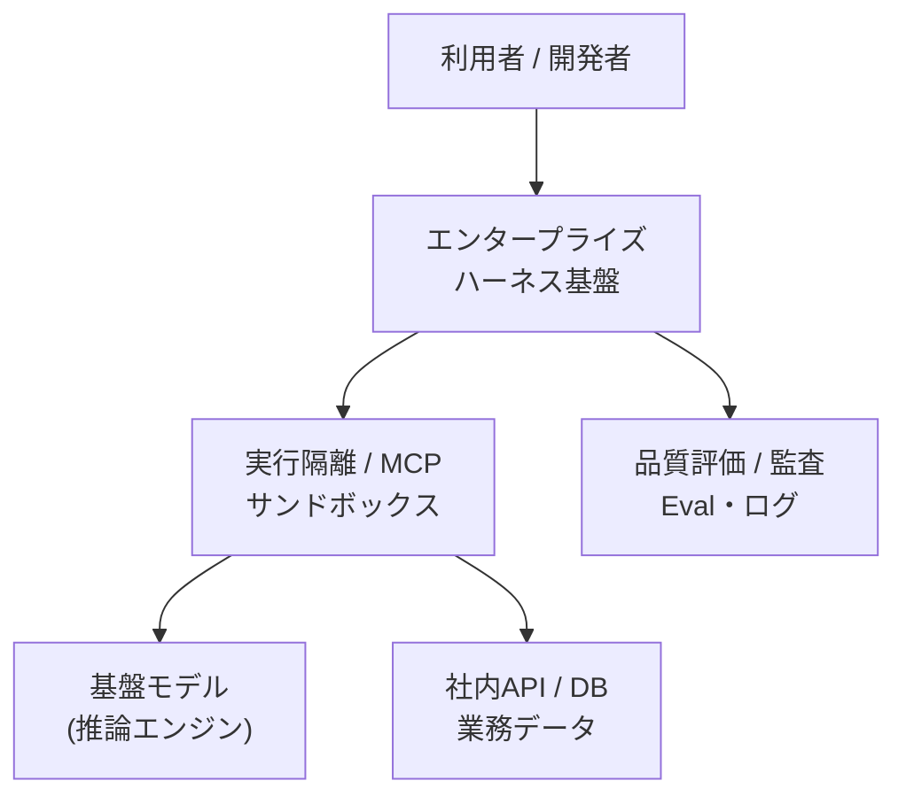

:::message
この記事は、生成AIを使って作成し、著者が内容を確認・修正したうえで公開しています。
:::

## 1. はじめに：企業導入における「モデル中心主義」の限界

大規模言語モデル（LLM）の発展に伴い、対話型AIやプログラミング支援ツールの導入が多くの組織で進みました。個人の作業効率化やアイデア出しの段階では一定の成果が得られている一方、基幹業務への本格的な組み込みや全社規模での自律型エージェント運用においては、共通の構造的課題が顕在化しています。

具体的には、モデル単体では組織固有の業務手順や過去の経緯を解釈できません。各部門が独自にプロンプトやスクリプトを構築することで品質の属人化を招き、権限管理と情報漏洩への懸念から本番環境への投入が進まない課題を生んでいます。

IPA（情報処理推進機構）が公開した『情報セキュリティ10大脅威 2026［組織編］解説』においても、組織の許可を得ずに従業員や部門が独自に生成AIを利用する「シャドーAI」のリスクが指摘されています。機密情報や個人情報の入力、誤った出力に基づく意思決定、知的財産侵害といった脅威への対応として、利用の全面禁止ではなく、安全に活用できる社内環境とガバナンス体制の整備が急務とされています。

こうした背景のもと、Thoughtworks は2026年11月発行の技術動向レポート『Technology Radar Vol. 35』を公開しました。本号では4大マクロテーマの筆頭に **「Harness engineering at scale（大規模なハーネスエンジニアリング）」** を掲げ、技術項目（Blip #27）として **「Enterprise harness（エンタープライズハーネス）」** を提示しています。

本稿では、個別のプロンプト設計から組織的な共通基盤へと焦点を移す「エンタープライズハーネス」の技術体系、アーキテクチャ上の責務分離、そして組織内の各ロールにおける体験の変化について論理的に整理します。

---

## 2. ハーネス（Harness）の技術的定義と責務分離

「ハーネス」という語は、自動車の電気配線を束ねるワイヤーハーネスや、高所作業用の安全帯、あるいは馬具の手綱や鞍を指します。これらに共通する性質は、「外部の大きな動力や入出力を安全に束ね、対象システムを制御下に置くための機構」という点です。

ソフトウェア工学の観点において、LLM は基本的に「入力テキストに対して確率論的な出力を返す、ステートレスな推論器」と位置づけられます。しかし、実業務で求められるタスクは、状態の保持、社内データベースの読み書き、外部APIの呼び出し、アクセス制御といった副作用を伴います。

### 推論エンジンと実行環境の分離

ここで、推論エンジン（LLM）と、それを取り巻く実行環境（ハーネス）の責務を明確に分離することが重要になります。

- **基盤モデル（LLM）の責務:** 自然言語の解釈、文脈に基づく推論、出力テキストや関数呼び出し要求の生成
- **ハーネス（Harness）の責務:** 
  - 業務文脈の抽出と動的なプロンプト組み立て（コンテキスト注入）
  - 社内APIやデータベースへの安全な接続インターフェース（MCP: Model Context Protocol やツール群）
  - 権限境界の設定とプロセスの隔離（サンドボックス）
  - 意図しない操作やポリシー違反を遮断する検査（ガードレール）
  - セッション情報や実行履歴の永続化（ステート管理）
  - 実行結果の妥当性検証と監査証跡の収集（評価・テレメトリ）

このように、**「推論モデルの外部に存在し、実務で安全に動作させるために必要な周辺機構の総体」** を設計・実装・保守する営みが「ハーネスエンジニアリング」であり、その成果物が「ハーネス」です。



---

## 3. なぜ今「エンタープライズ」ハーネスなのか：IDP との相同性

初期のエージェント導入では、個々の開発者やチームがプロンプトや連携コードを手組みする個別アプローチが主流でした。しかし、この方法を組織全体に拡大すると、セキュリティ基準のばらつき、社内API連携コードの重複実装、認可ポリシーの形骸化が生じます。前述の IPA による指摘と同様、Thoughtworks もこれを「AIによって加速されるシャドーIT」と呼び、重大なリスク要因として警鐘を鳴らしています。

### プラットフォームエンジニアリングの系譜

この課題構造は、クラウド黎明期から発展してきた **「プラットフォームエンジニアリング」** の歴史的経緯と相同関係にあります。

各開発チームが個別にインフラを立ち上げていた時代から、安全基準や可観測性を備えた「社内開発者プラットフォーム（Internal Developer Platform: IDP）」を提供する形態へと移行しました。エージェント環境においても同様に、標準化された共通プラットフォームが求められています。

Thoughtworks はレポート内で次のように述べています。

> 「より大きな課題は、エンタープライズの要件を満たすようハーネスをスケールさせることです。今後数か月のうちに、数年前にプラットフォームやプラットフォームエンジニアリングに起きたことと同様に、『エンタープライズハーネス（enterprise harness）』がひとつのプロダクトとして登場してくる可能性があります。」

エンタープライズハーネスとは、各チームの場当たり的な実装を排除し、**「全社共通の資産として統制・配布・継続改善される、エージェントのための共通基盤プロダクト」** です。従来の IDP が「開発者体験（Developer Experience: DX）」を支えるものであったのに対し、エンタープライズハーネスは「エージェントの実行体験（Agent Experience: AX）」を支えるインフラとして機能します。

---

## 4. エンタープライズハーネスのアーキテクチャ体系

Thoughtworks の提言やオープンソースの動向を踏まえると、エンタープライズハーネスは次の4つの主要コンポーネントで構成されます。

### 1. 部品流通網とパッケージ管理（Agent Plugin Marketplace / APM）
エージェントのスキル、指示定義、MCP サーバ仕様を、個人の端末から切り離し、バージョン管理された「プラグイン」として集約します。Thoughtworks Radar Vol. 35 で取り上げられた Agent Package Manager（Blip #72）などの仕組みを通じて、全社で承認済みのコンポーネントを宣言的に配布・導入します。

```yaml
# agent-manifest.yaml（構成定義の例）
name: "finance-audit-agent"
version: "1.0.0"
runtime:
  model: "claude-3-7-sonnet"
  timeout_seconds: 120
plugins:
  - source: "git@github.com:my-org/agent-plugins.git//finance-rules"
    version: "1.4.2"
tools:
  - name: "accounting-mcp"
    endpoint: "https://mcp.internal.example.com/accounting"
    read_only: true
guardrails:
  policy: "corporate-data-protection-v2"
  sandbox_level: "strict"
```

### 2. 客観的評価と品質ゲート（Harness quality evaluation）
ハーネスの更新やプロンプト変更の妥当性を、主観的な印象ではなく客観的なテストセットによって検証します（Blip #29）。消費トークン数や実行ステップ数といった「活動量」を追うのではなく、過去の障害事例や実業務トランザクションに基づくテストセットを実行し、タスクの成否や意図しない副作用の有無を判定します。

### 3. 実行隔離と影響範囲制御（Sandboxes & Blast radius）
エージェントが自律的にツールを呼び出す環境をコンテナや一時VMなどのサンドボックス内に隔離します。エージェントが不適切なコマンドを生成した場合でも、影響の及ぶ範囲（Blast radius: 爆発半径）を限定し、本番インフラや外部サービスへの波及を物理的に防止します。

### 4. 人間参加型の自己改善ループ（Feedback flywheel）
業務での実行ログや失敗トレースを収集し、ハーネス自体の改善候補（指示の曖昧さ解消やツールの追加）を機械的に抽出します。反映には必ず人間の承認を介在させます（*Automate the proposal, keep the approval*：提案は自動化し、承認は人間が残す）。安全性と監査性を担保しながら、組織知をハーネスへ継続的に蓄積できます。

オープンソースコミュニティにおいても、エージェント定義を標準化する [wshobson/agents](https://github.com/wshobson/agents) や、ハーネスの品質を自動検証・運用する取り組み（[pit-crew](https://github.com/Takenori-Kusaka/pit-crew) など）が進行しています。

---

## 5. 組織の各ロールにおけるアーキテクチャ的価値

エンタープライズハーネスの導入は、組織内の異なるステークホルダーに対して、それぞれ以下の技術的・運用的な価値をもたらします。

### セキュリティ・システム管理者の視点
- **シャドーAIの抑制と可視化:** 各部門が無秩序に外部ツールを利用する状態を防ぎ、公認のサンドボックス環境へと誘導できます。
- **ガバナンスと監査性の一元化:** どのエージェントがどのデータソースにアクセスしたかの監査ログ、トークン消費量、APIコストを一元的にモニタリングできます。

### 業務部門・一般利用者の視点
- **定型化された業務スキルの即時活用:** 個別に複雑なプロンプトを考案することなく、社内レジストリから承認済みのエージェントを選択するだけで、社内規定に準拠した支援を受けられます。
- **誤操作リスクの低減:** バックエンドでサンドボックスやガードレールが機能しているため、データ破壊や誤送信を過度に恐れることなく実務へ適用できます。

### ソフトウェアエンジニア・開発者の視点
- **関心事の分離（Separation of Concerns）:** 認証認可、ログ収集、サンドボックス基盤といった非機能要件を共通ハーネスに委譲できます。
- **ドメインロジックへの集中:** 開発者は、自社固有の業務ルールやスキーマ設計といったコアな価値創出に注力できます。

---

## 6. おわりに：差別化資産としてのハーネス設計

基盤モデルの性能向上とオープンウェイトモデルの普及により、モデルそのものはクラウドインフラと同様に代替可能なコモディティとなりつつあります。要件や運用コストに応じて、異なるベンダーのモデルへ柔軟に切り替えるマルチモデル運用が一般的になりつつあります。

このような環境において、他社と容易に代替できない企業の固有資産となるのは、**「自社の業務文脈、安全基準、システム連携仕様、そして過去の失敗の知見を体系的に実装した『ハーネス』そのもの」** です。

モデルというエンジンを最新のものへと載せ替えても、堅牢に設計されたエンタープライズハーネスが共通基盤として機能していれば、企業は安全性を損なうことなく、AI技術の進化を迅速に事業価値へ転換できます。

---

## 参考文献・関連情報

1. Thoughtworks, 『Technology Radar Vol. 35』, 2026年11月. https://www.thoughtworks.com/radar
2. Cecilia Geraldo, 「The harness is a product」, Thoughtworks Insights, 2026.
3. IPA（情報処理推進機構）, 『情報セキュリティ10大脅威 2026［組織編］解説』, 2026年. https://www.ipa.go.jp/security/10threats/omgdg50000008fi8-att/kaisetsu_2026_soshiki.pdf
4. GitHub, Takenori-Kusaka/pit-crew (Pull Request #5), 2026. https://github.com/Takenori-Kusaka/pit-crew/pull/5
5. GitHub, wshobson/agents. https://github.com/wshobson/agents
