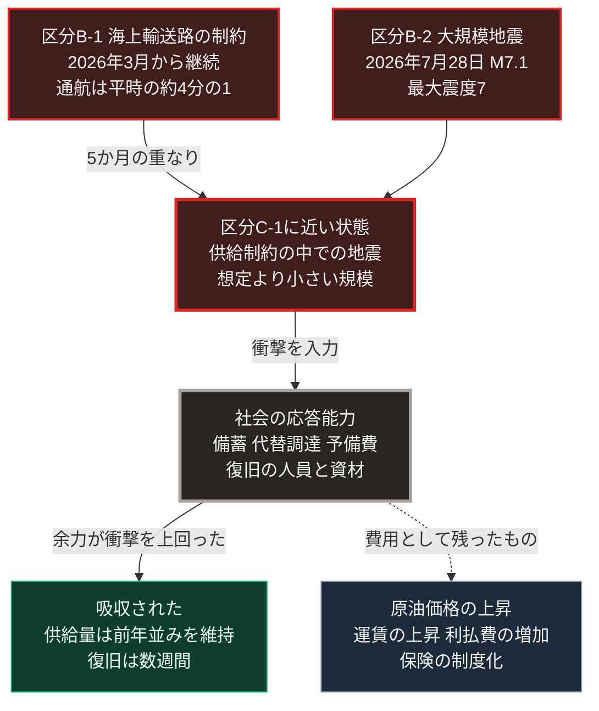

### 序論：本章が扱う範囲

本章は、[第Ⅲ部-10](scenario-comparison)で定義した早期警戒指標を、2026年10月27日時点の公的資料に照らして更新します。[第Ⅲ部-1](future-method)で述べたとおり、本書の記述は執筆時点で固定され、指標は現在を示します。本章は、その手続を本書自身に適用した最初の記録です。

対象の期間は、本書の初版が公開された2026年9月初めから同年10月27日までの約2か月です。ただし、この更新の作業で、初版の[第Ⅱ部](japan-current-state)が2026年に起きた2つの事象を記録していなかったことが判明しました。2026年2月28日に始まった中東の戦争と、それに続くホルムズ海峡の通航困難。そして、2026年7月28日の令和8年熊本地震です。いずれも、[第Ⅲ部-3](event-risk-catalog)で定義した区分Bの事象に該当します。本章は、第1節でこの欠落を補い、第2節以降で指標を更新します。

本章の前半は、公的資料による事実の記述です。後半の「本章の位置づけ」は、著者による解釈であり、初版の推論がどこまで妥当であったかの検証を含みます。

### 1. 初版が記録していなかった2つの事象

**海上輸送路の制約**

2026年2月、アメリカとイランの協議が再開しました。しかし同月28日、イスラエルとアメリカはイランを攻撃し、イランは周辺諸国へ反撃しました。イランはホルムズ海峡の閉鎖に言及し、海峡とその周辺で民間船舶が攻撃を受けました [ [ 600 ] ](https://www.mofa.go.jp/mofaj/gaiko/bluebook/2026/html/chapter2_07_02.html) 。日本の海運会社は3月1日に海峡の航行を停止し、政府は3月16日に国家備蓄原油の放出を決定しました [ [ 601 ] ](https://www.meti.go.jp/shingikai/enecho/shigen_nenryo/pdf/048_03_00.pdf) 。資源エネルギー庁の審議会は、原油タンカーの事実上ホルムズ海峡を通れない状況が長期にわたって生じたと記述しています [ [ 613 ] ](https://www.meti.go.jp/shingikai/enecho/shigen_nenryo/pdf/20260930_1.pdf) 。経過の詳細は、[第Ⅱ部B-2](report-iran-israel-conflict)の第6節に補いました。

**大規模地震**

2026年7月28日16時27分、熊本県の熊本地方でマグニチュード7.1の地震が発生し、宇城市と氷川町で震度7を観測しました。気象庁は、この地震とそれ以降の一連の活動を令和8年熊本地震と命名しました [ [ 616 ] ](https://www.jma.go.jp/jma/menu/20260728_kumamoto_jishin.html) 。同庁の月報は、2026年9月24日時点の消防庁の集計として、死者38人、負傷者373人、住家の全壊2,270棟、半壊6,357棟と記述しています [ [ 617 ] ](https://www.jma.go.jp/jma/press/2610/08b/2609kyusyu.pdf) 。資源エネルギー庁の資料によれば、熊本県内では最大約4万9千戸が停電し、高圧線の停電は7月31日、低圧線の停電は8月4日に復旧しました。都市ガスは最大約9,400戸で供給が止まり、八代市内では8月14日に約8,830戸で再開しました。被害の大きかった3市町のガソリンスタンド73か所のうち、7月30日に営業していたのは22か所で、8月21日には68か所まで戻りました [ [ 601 ] ](https://www.meti.go.jp/shingikai/enecho/shigen_nenryo/pdf/048_03_00.pdf) 。

この2つの事象は、時間の上で重なりました。熊本地震が発生した7月28日の時点で、ホルムズ海峡の通航は3月から5か月のあいだ制約を受けていました。[第Ⅲ部-3](event-risk-catalog)の区分C-1が想定した「海上輸送路の制約が発生している状態での大規模地震」が、想定より小さい規模で現実のものとなりました。

### 2. 指標0：余力の代理指標

[第Ⅲ部-10](scenario-comparison)は、公債依存度、利払費が歳出に占める割合、更新時期を迎える施設の割合、そして自治体別の更新費用と歳入の比率を余力の代理指標としました。

利払費については、財務省所管の2027年度の概算要求で16兆5,888億円となり、前年度当初から3兆5,516億円増えました [ [ 631 ] ](https://www.mof.go.jp/about_mof/mof_budget/budget/fy2027/20260828.html) 。財務省が2026年9月30日に審議会へ提出した資料によれば、要求上の金利は3.8%であり、2026年度当初の積算金利3.0%から上がりました。同資料は、現行の試算を機械的に延伸すると利払費が2035年度に35.9兆円へ達し、金利が想定より1%高ければ45.2兆円になると示しています [ [ 632 ] ](https://www.mof.go.jp/about_mof/councils/fiscal_system_council/sub-of_fiscal_system/proceedings/material/zaiseia20260930/01.pdf) 。市場の金利は、10年国債が2026年10月1日に3.092%、30年が4.122%に達した後、10月26日に10年が2.824%へ低下しました [ [ 634 ] ](https://www.mof.go.jp/jgbs/reference/interest_rate/jgbcm.csv) 。日本銀行は9月18日に政策金利を1.25%程度へ引き上げています [ [ 633 ] ](https://www.boj.or.jp/mopo/mpmdeci/mpr_2026/k260918a.pdf) 。

同じ方向の動きは、他国にも見られます。アメリカの2026会計年度の純利払費は1兆520億ドルで、財政赤字は1兆9,920億ドルでした [ [ 644 ] ](https://fiscaldata.treasury.gov/static-data/published-reports/mts/MonthlyTreasuryStatement_202609.pdf) 。ユーロ圏の政府債務は、2026年第2四半期末に国内総生産の88.8%です [ [ 663 ] ](https://ec.europa.eu/eurostat/web/products-euro-indicators/w/2-21102026-bp) 。

裁量余地については、観測できる事実が2つあります。第一に、政府は熊本地震の対応に予備費を充て、国家備蓄の放出で石油の供給を維持しました。第二に、内閣総理大臣は10月5日の所信表明演説で、債務残高の対国内総生産比を安定的に引き下げる目標を中核に置き、通年の国債発行額を適切にコントロールすると述べました [ [ 636 ] ](https://www.kantei.go.jp/jp/105/statement/2026/1005shoshinhyomei.html) 。

### 3. 指標1：生産性と労働

指標1-Aが見るのは、業務手順を実際に変更した組織の比率です。厚生労働省の労働経済白書は、企業におけるAIの利用率が日本では9.2%であり、OECD諸国の平均である20.2%の約半分以下であると記述しています [ [ 688 ] ](https://www.mhlw.go.jp/wp/hakusyo/roudou/26/dl/26-1-2.pdf) 。手順の変更率を直接示す公的統計は、本章の時点で確認できていません。

指標1-Cが見るのは、職種別の求人構成です。厚生労働省によれば、2026年8月の有効求人倍率は1.18倍であり、正社員の有効求人倍率は1.00倍でした [ [ 708 ] ](https://www.mhlw.go.jp/stf/newpage_76397.html) 。アメリカでは、スタンフォード大学の研究室が2026年10月21日の更新で、若年の労働者におけるAIへの曝露度に伴う雇用の差が19%へ広がったと示しました。同研究室は、広範な雇用の喪失は見られないと記述しています [ [ 689 ] ](https://digitaleconomy.stanford.edu/project/indicators/canaries-dashboard) 。

技術の側では、価格の低下が続きました。OpenAIは2026年10月26日、前の世代と同等の性能を10分の1の単価で提供するモデルを発表しました [ [ 709 ] ](https://openai.com/index/introducing-gpt-6-1-terra/) 。[第Ⅲ部-8](scenario-optimistic)の条件1は組織の適応速度であり、技術の価格ではありません。価格の低下は条件1の成立を容易にしますが、成立そのものではありません。

### 4. 指標2：供給方式の転換

エネルギーの自給率は、2024年度の確報値で16.3%へ上昇しました [ [ 638 ] ](https://www.enecho.meti.go.jp/statistics/total_energy/pdf/gaiyou2024fykaku.pdf) 。再稼働した原子炉は、2026年9月17日の時点で15基です [ [ 639 ] ](https://www8.cao.go.jp/genshiryoku_bousai/kyougikai/pdf/05_kk_shiryou21_3.pdf) 。

指標2-Cが見るのは、転換を制約する制度の改定です。経済産業省は2026年10月13日、原油等の調達を多角化する3つの法案の閣議決定を公表しました。指定した水路の利用の合理化に取り組む事業者への交付金、海上保険の契約が困難になった場合の政府の交付金、そして資源機構による輸送事業への出資と債務保証です [ [ 610 ] ](https://www.meti.go.jp/press/2026/10/20261013001.html) 。これは、海上輸送路の制約を受けて輸送経路を分散させる制度の改定です。一方、上下水道や電力の個別方式への転換を促す制度の改定は、本章の時点で確認できていません。

供給方式の設計に関する他国の動きとして、アメリカの国防長官は2026年9月30日、すべての主要な基地が民間の送電網から独立して自ら発電することを掲げました [ [ 647 ] ](https://www.war.gov/News/Speeches/Speech/Article/4616486/secretary-of-war-pete-hegseths-state-of-the-force-address-as-delivered) 。[第Ⅴ部](42_taoist-wu-wei-non-action)で検討する局所的な供給の設計が、軍事施設において先行する例です。

### 5. 指標3：区分Bの事象

**B-1 海上輸送路の制約**

指標3-Aは、周辺海域の航行状況と保険料率です。イギリス海軍の海上貿易の業務部門によれば、2026年3月1日以降に確認された船舶への事案は10月25日の時点で累計156件であり、ホルムズ海峡の脅威度は最も高い水準に置かれています。10月22日から24日の72時間にアメリカ軍の支援のもとで通航した船舶は101隻で、2025年の平均である1日約138隻を大きく下回ります [ [ 607 ] ](https://www.ukmto.org/-/media/ukmto/products/update-108-jmic-advisory-note-25-oct.pdf?rev=32a38b2b56f448f78f85fc33a48a1722) 。国際海事機関によれば、2月28日から9月16日までに80件の商船への攻撃が確認され、少なくとも22人の船員が死亡しました [ [ 606 ] ](https://www.imo.org/en/mediacentre/pressbriefings/pages/stop-attacking-ships-and-seafarers-imo-secretary-general.aspx) 。国際エネルギー機関によれば、9月の湾岸の原油輸出は戦前の水準の75%を超えるまで回復しましたが、石油製品の輸出は半分を下回っています [ [ 605 ] ](https://www.iea.org/reports/oil-market-report-october-2026) 。アメリカのエネルギー情報局は、中東からの供給の制約が2026年第4四半期まで続くと仮定しています [ [ 621 ] ](https://www.eia.gov/outlooks/steo/report/global_oil.php) 。

**B-2 大規模地震**

第1節で記述した令和8年熊本地震が、この区分の事象です。南海トラフ地震の臨時情報は、2026年9月から10月に発表されていません。一方、気象庁は2026年10月16日、千島列島を震源とする地震について規模を過大に推定した緊急地震速報の警報を北海道から中部地方に発表し、その後に取り消しました [ [ 713 ] ](https://www.jma.go.jp/jma/press/2610/16b/202610161400.html) 。

**B-3 インフラへの意図的な攻撃**

ウクライナでは、ロシア軍が2026年9月30日に電力と暖房の施設への大規模な攻撃を再開し、10月13日から14日の攻撃でキーウの約60万人が一時停電しました [ [ 656 ] ](https://ukraine.ohchr.org/en/Civilian-casualties-remain-at-record-levels-amid-intensifying-attacks-on-energy-as-winter-approaches) 。欧州では、エストニア政府が2026年9月29日、8月15日の防衛企業への放火をロシアの特務機関が委託した破壊工作と断定しました [ [ 711 ] ](https://valitsus.ee/en/news/russia-responsible-arson-attack-milrem) 。ポーランドの内務省は10月12日、9月23日に起きた衛星通信の地上局への放火について、外国の情報機関のための破壊工作の容疑で2人を拘束したと公表しました [ [ 712 ] ](https://www.gov.pl/web/mswia/zatrzymanie-sprawcow-podpalenia-stacji-starlink-na-mazowszu-skuteczna-akcja-mswia-policji-i-abw) 。

サイバー攻撃は、日本で供給の停止と大量の情報漏えいを生みました。警察庁が2026年9月に公表した上半期の情勢によれば、同期間のランサムウェアの被害報告は123件であり、統計を取り始めた2020年下半期以降で半期として最多でした。同庁のセンサーが検知した脆弱性の探索などの不審なアクセスは、前年同期比で51%増えました [ [ 716 ] ](https://www.npa.go.jp/publications/statistics/cybersecurity/data/R8kami/R08_kami_cyber_jousei.pdf) 。

事案は、9月下旬から10月中旬に集中しました。デジタル庁は9月11日、各府省庁が利用する共通基盤への不正アクセスを公表しました。第三者が接続機器の脆弱性から侵入し、保守運用の担当者のアカウントで大量のファイルにアクセスしたものであり、漏えいした可能性のある個人情報は約24万6千件です [ [ 724 ] ](https://www.digital.go.jp/news/2026-0911-01) 。佐川急便は10月23日、送り状データなどの流出した可能性のある個人情報を、重複を含む最大約5,323万件と公表しました。同社は、同一の顧客の情報が複数回含まれるため、この件数は実人数を示すものではないと記述しています [ [ 729 ] ](https://www2.sagawa-exp.co.jp/information/detail/430) 。ヤマト運輸の後払いサービスでは利用者情報約526万件が持ち出され [ [ 728 ] ](https://www.yamato-hd.co.jp/important/info_260929_1.html) 、パーク24のカーシェアでは本人確認書類の画像約146万件に外部送信の痕跡が確認されました [ [ 727 ] ](https://www.park24.co.jp/news/2026/10/20261023-1.html) 。Eストアーの店舗構築サービスでは約2,335万人 [ [ 723 ] ](https://estore.jp/press/20261016) 、ソースネクストでは約2,252万件の会員情報が取得されました [ [ 737 ] ](https://www.sourcenext.com/support/i/2026/1015_info/) 。

攻撃の多くは、多数の組織が共用する結節点を経由しました。IDCフロンティアによれば、2026年10月7日にクラウドサービスの東日本リージョン1の4つのゾーンがランサムウェアで停止し、495の企業と自治体が影響を受けました。同社は10月14日、仮想サーバー内のデータの外部への流出はなかったと判断する一方、バックアップからの取り出しが可能なのは、スナップショット機能を利用していた194の顧客であると公表しました [ [ 734 ] ](https://www.idcf.jp/news/topics/20261014001) 。この停止により、JR東日本は10月9日、会員向けのメール配信に使う外部サービスからメールアドレスなどが漏えいした可能性を公表しました [ [ 735 ] ](https://www.jreast.co.jp/press/2026/20261009_ho02.pdf) 。両毛システムズによれば、2026年8月12日に第三者が接続機器のアカウントを悪用して社内ネットワークへ侵入し、ランサムウェアの攻撃が確認されました。同社は自治体やガスと水道の事業者にシステムを提供しており、漏えいのおそれは取引先の顧客の個人情報に及びます [ [ 721 ] ](https://www.ryomo.co.jp/news/202609_02.html) 。NECは10月20日、システム開発と保守の委託先が9月下旬に攻撃を受け、窃取された正規アカウントの認証情報により複数の顧客のシステムでファイルが暗号化され、各種システムが利用できない状態になったと公表しました [ [ 732 ] ](https://jpn.nec.com/news/info/20261020.html) 。大阪公立大学では仮想化基盤がランサムウェアで停止し、全学のシステムが止まりました [ [ 731 ] ](https://www.omu.moe/news/2026-10-21-1d69aecb.html) 。重要施設の周辺でも事案が生じました。鳥取県は9月3日、原子力発電所の周辺を監視する環境放射線のシステムの主監視局がランサムウェアで停止し、副監視局で監視を継続したと公表しました [ [ 739 ] ](http://db.pref.tottori.jp/pressrelease.nsf/webview/1E29F3226152B1B649258E66001DE2E2?OpenDocument=) 。

政府の対応は、1週間に集中しました。国家サイバー統括室は10月14日、個人情報保護委員会、金融庁、総務省、経済産業省、情報処理推進機構などが10月7日から13日に出した注意喚起を一覧にまとめ、不正アクセスによる漏えいが幅広い分野で相次いでいると記述しました [ [ 717 ] ](https://www.cyber.go.jp/news/20261014.html) 。金融庁は10月9日、本人確認書類の画像の流出を踏まえ、ICチップの読み取りによる本人確認への早期の移行を要請しています [ [ 719 ] ](https://www.fsa.go.jp/news/r8/sonota/20261009/20261009.html) 。サイバー対処の能力を強化する法律のうち官民連携とアクセス・無害化措置の部分は、2026年10月に施行されました [ [ 643 ] ](https://www.cas.go.jp/jp/seisaku/boueiryoku_kaigi/sogoteki_dai4/shiryo1.pdf) 。

国外でも、同じ型の事案が公表されています。アメリカの当局は10月8日、中国政府と結びつく企業が自動化された走査と大規模なボットネットと手作業の侵入を組み合わせ、重要インフラを含む組織から情報を窃取していると勧告しました [ [ 740 ] ](https://www.cisa.gov/news-events/cybersecurity-advisories/aa26-281a) 。同当局は10月20日、2024年8月以降に複数の重要インフラの部門で600を超える被害者を生んだランサムウェアに関する勧告も公表しました [ [ 710 ] ](https://www.cisa.gov/news-events/cybersecurity-advisories/aa26-293a) 。連邦捜査局と環境保護庁は、少なくとも7つの州の上下水道の事業者で、インターネットに露出した制御装置の設定が改変され、運用に影響が出たと警告しています [ [ 741 ] ](https://www.fbi.gov/investigate/cyber/alerts/2026/malicious-cyber-actors-targeting-water-and-wastewater-sector-internet--facing-programmable-logic-controllers-causing-operational-disruptions) 。欧州連合のサイバーセキュリティ機関は2026年9月22日の脅威報告で、供給網と第三者への依存が攻撃の表面を広げていると総括しました [ [ 742 ] ](https://www.enisa.europa.eu/publications/enisa-threat-landscape-2026) 。国際通貨基金は10月12日、サイバー攻撃を金融システムのリスクの増大する源と位置づけ、クラウドなどの重要な第三者への監督の強化を提言しました [ [ 743 ] ](https://www.imf.org/en/blogs/articles/2026/10/12/global-financial-markets-face-rising-risks-from-ai-bond-yields-and-cyberattacks) 。

**B-5 暗号方式の移行に伴う障害**

2026年9月18日に公開された研究は、2,048ビットの整数を約12万個の物理素子で1か月以内に素因数分解できると示しました [ [ 685 ] ](https://arxiv.org/abs/2609.21249) 。Googleは10月15日、特定の論理状態の誤りを約40分の1に減らしたと公表しました [ [ 686 ] ](https://blog.google/innovation-and-ai/models-and-research/quantum-computing/magic-state-cultivation-quantum-computing) 。[第Ⅲ部-3](event-risk-catalog)が早期警戒指標とした「必要資源の見積もりの改訂」は、縮小の方向で続いています。

**B-6 感染症の広域流行**

世界保健機関によれば、コンゴ民主共和国で2026年5月に宣言された国際的に懸念される公衆衛生上の緊急事態は、10月23日の時点で継続しています。同機関は、渡航と貿易の制限に反対しています [ [ 714 ] ](https://www.who.int/emergencies/disease-outbreak-news/item/2026-DON622) 。[第Ⅲ部-3](event-risk-catalog)の指標のうち、緊急事態の宣言は該当し、渡航制限は該当していません。

**指標3-C 当事国間の協議**

アメリカと中国の間では、2026年9月の国事訪問で人工知能の事案に関する連絡経路の設立と、両軍の危機の意思疎通に関する覚書の早期署名が合意されました [ [ 672 ] ](https://www.fmprc.gov.cn/zyxw/202609/t20260926_12031616.shtml) 。日本と中国の間では、外交部が9月28日に日中関係が再び厳しい局面にあると述べ [ [ 677 ] ](https://www.fmprc.gov.cn/wjbzhd/202609/t20260928_12032785.shtml) 、日本の外務大臣は懸案があるからこそ意思疎通が重要であると述べました [ [ 676 ] ](https://www.mofa.go.jp/mofaj/press/kaiken/kaikenw_000001_00258.html) 。日本周辺の緊急発進は2026年度上半期に442回であり、前年同期の265回を上回りました [ [ 669 ] ](https://www.mod.go.jp/js/pdf/2026/p20261016_07.pdf) 。北朝鮮は2026年10月12日に少なくとも2発の弾道ミサイルを発射し、1発は910キロメートル超を飛翔しました [ [ 715 ] ](https://www.mod.go.jp/j/press/news/2026/10/12e.html) 。

### 6. 指標4：事実に関する共通認識

指標4-Bは、災害時の情報伝達の実績です。熊本地震では、政府が被害の状況を定期的に公表し、避難所の数と避難者数を更新しました。10月5日の時点で避難所は28か所、避難者は1,288人であり、最大時は506か所、9,931人でした [ [ 625 ] ](https://www.bousai.go.jp/updates/r8kumamoto_jishin/status/pdf/r8kumamoto_jishin_20261005.pdf) 。一方、第5節で記述した緊急地震速報の過大な推定とその取り消しは、正確な情報が共有されるまでの時間を測る事例となります。

指標4-Aの制度への信頼度と指標4-Cの根拠を提示する設計については、本章の期間に該当する公的な調査結果を確認できていません。

### 7. 対応表への当てはめ

前節までの観測を、[第Ⅲ部-10](scenario-comparison)の対応表に当てはめます。数値の閾値は示さず、方向のみを判定します。

| 指標 | 2026年10月時点の観測 | 接近する列 |
| --- | --- | --- |
| 指標0 余力の代理指標 | 利払費の要求が3.6兆円増、要求金利が3.0%から3.8%へ、長期金利は一時3%台 | ベースライン（いずれかが上昇を継続） |
| 指標1-A 手順の変更率 | 企業のAI利用率は9.2%、手順の変更率の統計は未確認 | ベースライン（導入率のみ観測） |
| 指標1-C 職種別の求人構成 | 有効求人倍率1.18倍で横ばい、構成の変化は緩慢 | ベースライン |
| 指標2-A 給水区域の縮小と個別方式 | 新たな公的統計を確認できず | 判定せず |
| 指標2-C 転換を制約する制度の改定 | 原油等の輸送経路を分散させる3法案を閣議決定 | 楽観（改定が実施）とベースラインの間 |
| 指標3-A 周辺海域の航行状況と保険料率 | 事案が累計156件、脅威度は最高水準、通航は平時の約4分の1 | 悲観（上昇が持続し迂回が常態化） |
| 指標3-B 重要設備への探索行為 | 不審なアクセスが前年比51%増、ランサムウェア被害が半期最多、共用基盤の停止で495組織に波及 | 悲観（増加し実害を伴う事案が発生） |
| 指標3-C 当事国間の協議 | 米中は連絡経路を拡充、日中は政府間の会談なし | 相手による（米中は楽観、日中はベースラインから悲観） |
| 指標4-B 災害時の情報伝達 | 被害情報の定期公表は機能、緊急地震速報の過大推定を取り消し | ベースライン（変化なし） |

### 🗺️ 図：2026年の衝撃と余力の関係

[第Ⅲ部-3](event-risk-catalog)の図が示した「余力と衝撃の関係」に、2026年の事象を当てはめます。

#### 図の読み方

上段の2つの箱は、2026年に現実のものとなった区分Bの事象です。左が海上輸送路の制約、右が大規模地震です。2つから矢印が中段の箱へ集まります。この箱は、[第Ⅲ部-3](event-risk-catalog)で定義した区分C-1に近い状態を表します。ただし、地震の規模は南海トラフの想定より1桁小さく、供給制約も全面的な遮断ではありませんでした。

中段から下段へ、矢印は社会の応答能力を経て2つに分かれます。実線の矢印は、観測された帰結です。供給量は備蓄の放出と代替調達によって前年並みに保たれ、熊本の電力と都市ガスは数週間で復旧しました。第Ⅲ部-3の図における「余力が衝撃を上回る」経路をたどったことになります。

点線の矢印は、吸収の過程で費用として残ったものです。原油価格の上昇、タンカーの運賃の上昇、そして利払費の増加です。保険については、政府が交付金で補う制度を法案として提出しました。これらは衝撃そのものではなく、次の衝撃に備える余力を削る要因です。[第Ⅰ部A-8](dynastic-cycle-and-corruption)で整理した崩壊の構造に照らせば、吸収された衝撃であっても、吸収の費用が余力の逓減を速めるという経路にあたります。

この図が示す最も重要な点は、初版が区分C-1として想定した組み合わせが、小さい規模で現実に生じ、そして吸収されたという事実です。吸収を可能にした要素のうち、国家備蓄と産油国との共同備蓄は、初版の指標0に含まれていませんでした。この点は、章末で扱います。

---

### 本章の位置づけ

本セクションは、著者による解釈です。前節までの記述とは区別して読んでください。

1.  **初版の推論はどこまで妥当であったか**

    [第Ⅱ部B-2](report-iran-israel-conflict)の初版は、海峡の迂回路の容量が通過量の約13%にとどまるため、遮断が生じた場合に供給量の減少は避けられないと推論しました。2026年の経過は、この推論の前半を裏づけました。湾岸の石油輸出は8月に戦前のほぼ半分まで減り、迂回路のパイプラインも9月に攻撃を受けました。

    一方、推論の後半は、日本についてはそのままの形では成立しませんでした。日本の原油処理量は、4月に前年同月比で13.7%低下したのち5月以降に前年並みへ戻り、燃料油の国内向け販売量は97.9%から99.7%の範囲で維持されました。差を埋めたのは、約8か月分とされる石油備蓄の放出と、ホルムズ海峡を経由しない調達先への切り替えです。初版の指標0は、公債依存度と利払費と施設の更新費用を余力の代理指標としましたが、備蓄の日数を含めていませんでした。本章の観測は、備蓄が余力の一部として機能したことを示します。この欠落は、初版の誤りとして記録します。

    吸収は無償ではありませんでした。4月のタンカーのスポット運賃は前年同月の約11倍に達し、国際エネルギー機関によれば世界の石油需要は2026年に日量260万バレル減る見込みです。吸収の費用は価格と財政に残り、余力の逓減を速めます。

2.  **シナリオの現在地**

    [第Ⅲ部-10](scenario-comparison)の分岐の行列に照らすと、2026年10月時点の日本は次の位置にあります。縦軸の余力は逓減しています。利払費の要求額と要求金利の上昇、長期金利の一時的な3%超えがその証拠です。横軸の区分Bは、単発ではなく、海上輸送路の制約と大規模地震が重なりました。しかし衝撃は余力の範囲内で吸収されました。行列のマスとしては、「余力の逓減」の行と「複数が近接して発生」の列の交点にありながら、帰結はベースラインに近いものでした。

    初版の第Ⅲ部-10は、このマスについて次のように記述しました。「余力を保ち代替方式を実装した状態で区分Bが複合した場合、供給停止の範囲は限定され、経過はベースラインに近づく」。2026年の経過は、余力が保たれていたのではなく逓減していた点でこの記述と異なりますが、備蓄という代替の手段が実装されていた点では同じです。したがって本書は、現在地をベースラインの枠内にあり、悲観側へ寄った状態と評価します。

    指標の方向を列ごとに見ると、指標3-Aと指標3-Bは悲観の列に入りました。指標0と指標1はベースラインの列にあります。指標2-Cは、輸送経路の分散という限られた領域で楽観の列へ動きました。

3.  **結節点への攻撃が示すこと**

    第5節で記述したサイバー事案の連鎖には、1つの型があります。攻撃を受けたのは、多数の組織が共用する結節点でした。共用のクラウド基盤、自治体や公益事業者にシステムを提供する事業者、大手ベンダーの委託先、そして政府の共通基盤です。1か所の侵害が、数百の組織と数千万件の情報へ波及しました。

    これは、[第Ⅱ部C-1](15_platform-capitalism-centralization)から[第Ⅱ部D-6](40_cloud-lockout-wan-cutout)で整理した集約の構造が、効率の裏面として持つ性質です。依存先が少数に集約されるほど、1つの結節点の停止が波及する範囲は広がります。本書はこの構造を物理的な設備について論じてきましたが、2026年秋の事案は、情報基盤において同じ構造が同じ帰結を生むことを示しました。帰結を分けたのは、顧客が自らのバックアップを持っていたかどうかです。これは、[第Ⅴ部](42_taoist-wu-wei-non-action)で検討する局所に複製を持つ設計の要請に直結します。

4.  **外れる条件の点検**

    [第Ⅲ部-7](scenario-baseline)が示した3つの外れる条件を点検します。第一の条件は、区分Bが複合または余力を超えることでした。複合は生じましたが、余力は超えませんでした。この条件は、部分的に満たされ、帰結としては満たされていません。第二の条件は、生成AIの能力が想定を超えて向上することでした。本章の期間に観測されたのは能力の向上より価格の低下であり、この条件の判定は保留します。第三の条件は、制度の抜本的な再設計でした。輸送経路の分散に関する法案は制度の改定ですが、供給方式や社会保障の再設計には至っていません。

    したがって、初版のベースラインは、2026年10月の時点で外れていません。ただし、第一の条件が「帰結として」満たされなかった理由は備蓄でした。備蓄は放出すれば減ります。次の衝撃が到来したときの余力は、2026年2月の時点より小さくなっています。

5.  **指標の改定**

    本章の観測から、第Ⅲ部-10の指標に2つの追加を提案します。第一に、指標0に石油と液化天然ガスの備蓄日数を加えること。資源エネルギー庁は備蓄量の日報を2026年3月17日から公表しており、観測は可能です。第二に、指標3-Bに、国内の共用の処理基盤における攻撃による停止の件数と、顧客が自らのバックアップを持っていた比率を加えること。本章の期間に生じた事例は、依存先の停止が顧客の備えによって帰結を分けることを示しました。

6.  **次の観測点**

    本章の時点で日付が確定している観測点を挙げます。2026年10月28日にアメリカの中央銀行の決定、10月29日から30日に日本銀行の決定があります。11月3日にアメリカの中間選挙、11月9日から20日にアンタルヤで気候変動の締約国会議があります。ロシアは11月10日頃の三者協議の再開を表明し、アメリカと中国の関税措置の停止は2027年1月10日が期限です。日本では、3つの安全保障の文書の改定が2026年中に予定され、アメリカの歳出のつなぎ予算は12月11日に期限を迎えます。これらの帰結は、本書の次の観測記録で扱います。

7.  **本章の限界**

    本章の期間は約2か月です。本書の指標の多くは年次の統計に依存し、2か月では方向を判定できないものが残りました。指標2-A、指標4-A、指標4-Cは、判定を保留しています。また、本章は2026年10月27日の時点で固定されます。読者は、本章の表の各行を自らの時点の公的資料で上書きできます。それが、本書が意図した使われ方です。
