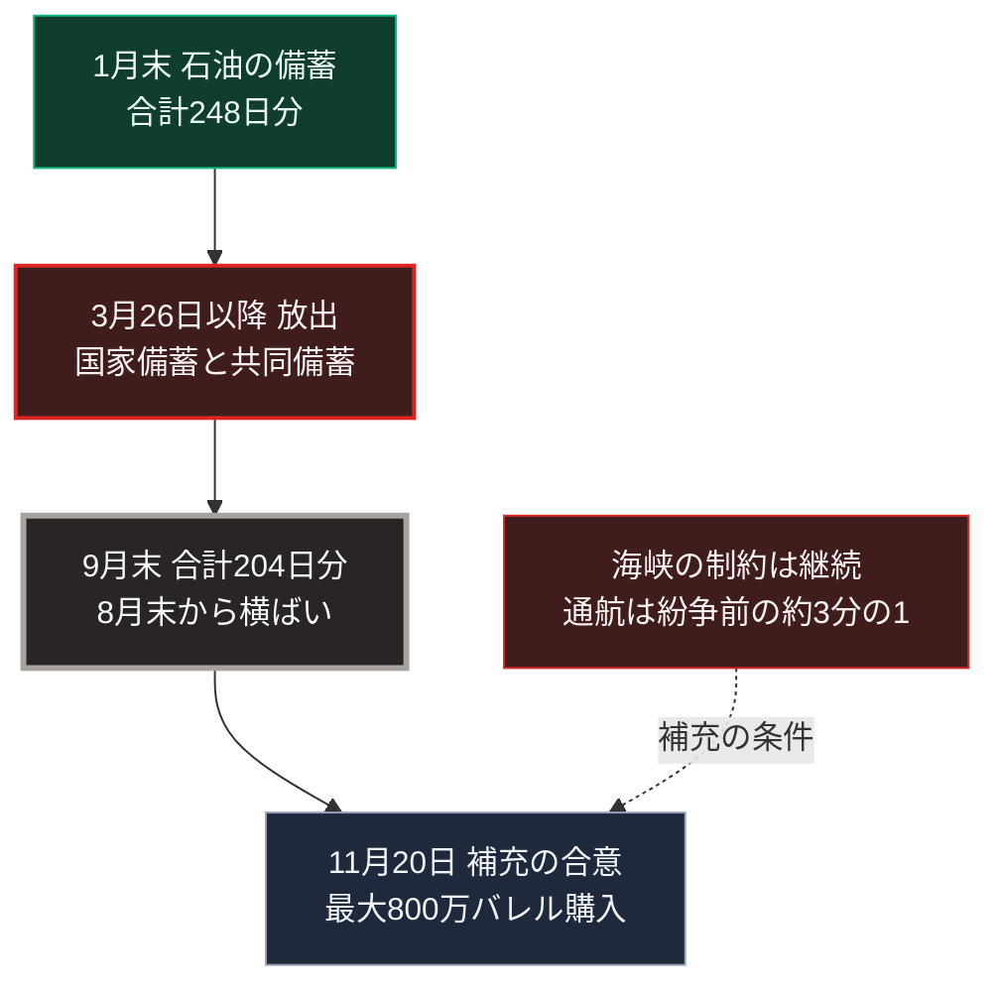

### 序論：本章が扱う範囲

本章は、[第Ⅲ部-10](scenario-comparison)で定義した早期警戒指標を、2026年11月26日時点の公的資料に照らして更新します。[第Ⅲ部-11](observation-record-2026-10)に続く2回目の観測記録です。形式は前回と同じであり、指標ごとの事実の記述、対応表への当てはめ、章末の解釈の順に進みます。

対象の期間は、前回の記録を固定した2026年10月27日の翌日から、同年11月26日までの約1か月です。前回の記録が章末に挙げた観測点のうち、日付が期間内にあったものは、各節と第7節で帰結を記述します。また、今回の作業で、前回の記録が期間内の事象を1つ記録していなかったことが判明しました。国際刑事裁判所に対するアメリカの制裁です。第1節でこの欠落を補います。

本章の前半は、公的資料による事実の記述です。後半の「本章の位置づけ」は、著者による解釈です。

### 1. 前回の記録が記録していなかった事象

アメリカは2026年8月18日、国際刑事裁判所の赤根智子所長を制裁の対象に指定しました [ [ 744 ] ](https://www.state.gov/releases/office-of-the-spokesperson/2026/08/advancing-the-united-states-campaign-to-address-the-threat-posed-by-the-international-criminal-court) 。同年10月9日には、裁判所そのものを制裁の対象に指定しています [ [ 745 ] ](https://www.state.gov/releases/office-of-the-spokesman/2026/10/imposing-sanctions-on-the-international-criminal-court-2) 。日本を含む8か国の外務大臣は10月10日、この制裁に反対する共同声明を出しました [ [ 746 ] ](https://www.mofa.go.jp/mofaj/gaiko/icc/index.html) 。

いずれも前回の記録の期間内の事象であり、[第Ⅲ部-10](scenario-comparison)の指標3-Cが見る国家間の関係に関わります。第5節で記述する11月19日の首脳の宣言は、この経過の上にあります。

### 2. 指標0：余力の代理指標

利払費については、財務省の審議会が2026年11月20日に財務大臣へ提出した建議が、普通国債の残高が1,000兆円を超え、2027年度の概算要求における利払費は過去最大の16.6兆円であると記述しています。同建議は、国債の借換えなどを通じて金利の上昇が利払費のさらなる増加に波及し、政策的経費を圧迫していくと述べています [ [ 747 ] ](https://www.mof.go.jp/about_mof/councils/fiscal_system_council/sub-of_fiscal_system/report/zaiseia20261120/01.pdf) 。

市場の金利は、本章の期間に10年国債が2.696%から2.927%、30年国債が3.898%から4.082%の範囲で推移しました。確認できた最新の11月24日の時点で、10年は2.781%、30年は3.990%です [ [ 634 ] ](https://www.mof.go.jp/jgbs/reference/interest_rate/jgbcm.csv) 。日本銀行は10月30日、政策金利を1.25%程度に据え置きました。採決は8対1であり、反対した1人の委員は1.5%程度への引き上げを提案しました。同じ会合は、保有する上場投資信託の売却のペースを、2027年1月から年間8,600億円程度（簿価）へ引き上げることを決めています [ [ 748 ] ](https://www.boj.or.jp/mopo/mpmdeci/mpr_2026/k261030a.pdf) 。

裁量余地については、予備費の残高が観測できます。中東情勢などに対応する予備費は2兆5,000億円が計上されています。10月30日に燃料油価格の激変緩和対策などへ1兆1,481億円の使用が閣議決定されました [ [ 749 ] ](https://www.mof.go.jp/policy/budget/budger_workflow/budget/fy2026/r81030kakugikettei.pdf) 。11月13日には電気とガスの料金の負担軽減などへ6,519億円の使用が決定され、その後の残額は約840億円です [ [ 750 ] ](https://www.mof.go.jp/policy/budget/budger_workflow/budget/fy2026/r81113kakugikettei.pdf) 。一般の予備費からは、11月6日にサイバーセキュリティ対策の強化へ約100億円が充てられました [ [ 751 ] ](https://www.mof.go.jp/policy/budget/budger_workflow/budget/fy2026/r81106kakugikettei.pdf) 。2026年度の補正予算の第2号は、本章の時点で確認できていません。

他国では、アメリカの中央銀行が10月28日、政策金利の誘導目標を3.75%から4%に据え置きました。採決は10対2であり、反対した2人は0.25%の引き上げを主張しました [ [ 752 ] ](https://www.federalreserve.gov/newsevents/pressreleases/monetary20261028a.htm) 。アメリカの2027会計年度の最初の月である2026年10月の財政赤字は4,041億ドルで、前年同月の2,843億ドルを上回りました。同国の財務省は、11月1日が休日にあたったため、一部の給付の支払いが10月へ前倒しされたと注記しています [ [ 753 ] ](https://fiscaldata.treasury.gov/static-data/published-reports/mts/MonthlyTreasuryStatement_202610.pdf) 。

**備蓄の日数**

前回の記録は、石油と液化天然ガスの備蓄日数を指標0に加えることを提案しました。資源エネルギー庁の月次の統計によれば、石油の備蓄は2026年1月末に国家備蓄146日分、民間備蓄96日分、産油国との共同備蓄6日分、合計248日分でした [ [ 754 ] ](https://www.enecho.meti.go.jp/statistics/petroleum_and_lpgas/pl001/pdf/2026/260317oil.pdf) 。11月に公表された9月末の値は、国家備蓄103日分、民間備蓄95日分、産油国との共同備蓄6日分、合計204日分です。同庁は、3月26日以降に国家備蓄と産油国との共同備蓄の放出を始め、民間の備蓄の義務量を70日分から55日分へ引き下げていると記述しています [ [ 755 ] ](https://www.enecho.meti.go.jp/statistics/petroleum_and_lpgas/pl001/pdf/2026/261116oil.pdf) 。合計は1月末から44日分減り、8月末の204日分から9月末まで横ばいです。発電用の液化天然ガスには、石油のような日数の統計がありません。大手電力の在庫の量の公表は、本章の時点で確認できた最新が7月5日時点の233万トンです [ [ 756 ] ](https://www.enecho.meti.go.jp/category/electricity_and_gas/electricity_measures/pdf/denryoku_LNG_stock.pdf) 。

### 3. 指標1：生産性と労働

指標1-Aの手順の変更率と、企業のAI利用率について、本章の期間に公表された公的統計は確認できていません。

指標1-Bの労働生産性について、日本生産性本部は2026年11月11日、2025年度の時間当たりの実質の労働生産性が前年度比1.4%上昇したと公表しました。1人当たりの実質の上昇率は0.4%です。同本部は、2026年に入ってからの四半期の伸びは1%未満でほぼ横ばいであると記述しています [ [ 757 ] ](https://www.jpc-net.jp/research/detail/008260.html) 。内閣府が11月16日に公表した2026年7〜9月期の1次速報で、実質の国内総生産は年率0.1%減でした。民間の最終消費支出は前期比0.3%減、民間企業設備は1.6%増です [ [ 758 ] ](https://www.esri.cao.go.jp/jp/sna/data/data_list/sokuhou/files/2026/qe263/tables/nritu-jk2631.csv) 。

指標1-Cの求人構成について、厚生労働省によれば、2026年9月の有効求人倍率は1.19倍、正社員の有効求人倍率は1.01倍であり、いずれも前月から0.01ポイント上がりました。新規求人は前年同月比で製造業が8.2%、情報通信業が5.9%増え、生活関連サービス業・娯楽業が6.7%減りました [ [ 759 ] ](https://www.mhlw.go.jp/stf/newpage_76960.html) 。10月分の公表は12月1日の予定であり、本章の期間に含まれません。

### 4. 指標2：供給方式の転換

再稼働した原子炉は15基のままであり、本章の期間に新たな再稼働は確認できていません。原子力規制委員会の11月12日更新の運転状況では、このうち12基が運転中です [ [ 760 ] ](https://www.nra.go.jp/jimusho/operation_status.html) 。

指標2-Bの蓄電設備について、資源エネルギー庁が11月20日に審議会へ提出した資料によれば、9月末の時点で系統に連系済みの系統用蓄電池は169万キロワットであり、契約の申込みを受け付けたものは約4,400万キロワットです [ [ 761 ] ](https://www.meti.go.jp/shingikai/enecho/denryoku_gas/saisei_kano/smart_power_grid_wg/pdf/014_02_00.pdf) 。これらは送電網に接続して運用する設備です。系統から独立して運用できる比率を示す統計は、本章の時点で確認できていません。

指標2-Cの制度の改定について、10月13日に閣議決定された原油などの調達を多角化する3つの法案は、本章の時点で成立していません。指定した水路の利用の合理化に関する法案と、海上保険の契約の履行を確保する特別措置の法案は、11月10日に衆議院で可決され、参議院の委員会へ付託されました [ [ 762 ] ](https://www.sangiin.go.jp/japanese/joho1/kousei/gian/222/meisai/m222080222011.htm) [ [ 763 ] ](https://www.sangiin.go.jp/japanese/joho1/kousei/gian/222/meisai/m222080222012.htm) 。資源機構による輸送事業への出資と債務保証を定める法案は、11月24日に衆議院で可決されました [ [ 764 ] ](https://www.sangiin.go.jp/japanese/joho1/kousei/gian/222/meisai/m222080222013.htm) 。

上下水道については、国土交通省が10月29日の資料で予算の要求事項を示しました。水道の施設の再編への支援対象の拡充と、下水道区域の廃止に伴う管路の撤去への支援の拡充です [ [ 765 ] ](https://www.nilim.go.jp/lab/eag/pdf/20261029_6_doukou.pdf) 。これは予算の要求の段階です。給水区域の縮小や個別方式への転換を決定した自治体の数を示す公的統計は、本章の時点で確認できていません。

### 5. 指標3：区分Bの事象

**B-1 海上輸送路の制約**

指標3-Aは、周辺海域の航行状況と保険料率です。イギリス海軍の海上貿易の業務部門が配布する合同海上情報センターの更新によれば、2026年3月1日以降に確認された船舶への事案は11月22日の時点で累計194件であり、10月25日の156件から38件増えました。ホルムズ海峡の脅威度は最も高い水準に据え置かれ、11月20日と21日にはオマーンの沖で外向きに航行するタンカー3隻が被弾しました [ [ 766 ] ](https://www.ukmto.org/-/media/ukmto/products/jmic_advisory_update_116_22-nov.pdf) 。同部門の週次の集計では、11月20日までの7日間の通航は外向き115隻、内向き148隻であり、紛争前の水準を約65%下回りました [ [ 767 ] ](https://www.ukmto.org/-/media/ukmto/products/20261120-ukmto_vra_overview_u.pdf) 。アメリカによるイランの港湾の封鎖は、11月18日の時点で継続しています [ [ 768 ] ](https://www.ukmto.org/-/media/ukmto/products/jmic-advisory-note-01726-blockade-update.pdf) 。

国際海事機関によれば、2月28日以降にホルムズ海峡で確認された商船への攻撃は130件を超え、少なくとも25人の船員が死亡しました [ [ 769 ] ](https://www.imo.org/en/MediaCentre/PressBriefings/pages/IMO-Secretary-General-calls-for-enforcement-of-maritime-rules.aspx) 。国際エネルギー機関の11月13日の報告によれば、10月の湾岸の石油輸出（オマーンを除く）は日量1,840万バレルで、戦前の水準を26%下回りました。原油は戦前の82%まで戻りましたが、石油製品と液化石油ガスの輸出はおよそ半分にとどまっています [ [ 770 ] ](https://www.iea.org/reports/oil-market-report-november-2026) 。アメリカのエネルギー情報局は11月10日の見通しで、中東からの供給がある程度の制約を受け続けると仮定しています [ [ 621 ] ](https://www.eia.gov/outlooks/steo/report/global_oil.php) 。停戦や海峡の再開の合意は、本章の時点で確認できていません。

日本では、経済産業省が11月20日、サウジアラビアとの共同声明を公表しました。日本は国家備蓄の基地も使って最大1,600万バレルのタンクを同国に期限付きで貸し出し、国家備蓄の補充のために同国から最大800万バレルの原油を購入するとしています [ [ 771 ] ](https://www.meti.go.jp/files/000007964.pdf) 。

**B-2 大規模地震**

本章の期間に、最大震度5弱以上の地震が3回観測されました。10月29日に千葉県北東部の地震で震度5弱を観測し、人的・住家の被害の報告はありませんでした [ [ 772 ] ](https://www.fdma.go.jp/disaster/info/items/20261029chibahokutoubujishin3.pdf) 。11月8日には深さ41キロメートルでマグニチュード5.7の地震が発生し、愛知県知多市で震度5強を観測しました。気象庁の発表によれば、この地震は南海トラフ地震の想定震源域の中で発生しましたが、その規模からプレート間の固着状態の特段の変化を示すものではないと考えられます [ [ 773 ] ](https://www.jma.go.jp/jma/press/2611/08a/kaisetsu202611080305.pdf) 。同庁の月報は、この地震で負傷者22人の被害が生じたと記述しています [ [ 774 ] ](https://www.jma.go.jp/jma/press/2611/10b/2610kanto-chubu.pdf) 。11月19日には熊本県天草・芦北地方でマグニチュード5.7の地震が発生し、5市町村で震度5弱を観測しました。同庁は、この地震を令和8年熊本地震の一連の活動と位置づけています [ [ 775 ] ](https://www.jma.go.jp/jma/press/2611/19a/202611190425.html) 。

南海トラフ地震の臨時情報は、本章の期間に発表されていません。評価検討会は11月9日に定例の会合を開き、大規模地震の発生の可能性が平常時と比べて相対的に高まったと考えられる特段の変化は観測されていないと評価しました [ [ 776 ] ](https://www.jma.go.jp/jma/press/2611/09a/nt20261109.html) 。

令和8年熊本地震の被害は、消防庁の11月18日の集計で死者43人（うち災害関連死6人）、負傷者390人、住家の全壊2,891棟、半壊10,597棟です [ [ 777 ] ](https://www.fdma.go.jp/disaster/info/items/5b59fd22bf143176cd7d412eb0349c79796eac56.pdf) 。前回の記録が引用した9月24日時点の死者38人、全壊2,270棟から、いずれも増えました。

**B-3 インフラへの意図的な攻撃**

ウクライナでは、電力への攻撃が10月に強まりました。国際連合の人権監視団は11月17日、ロシア軍が10月にウクライナ全土のエネルギー施設への攻撃を大幅に強め、ウクライナの当局が全国で計画停電を実施したと公表しました。同監視団によれば、10月の民間人の死者は少なくとも372人です [ [ 778 ] ](https://ukraine.ohchr.org/en/In-Ukraine-Civilians-Die-at-Alarming-Rates-Amid-Intensifying-Attacks-UN-Human-Rights-Officials-Say) 。国際原子力機関によれば、ザポリージャ原子力発電所は11月8日、唯一残る送電線の損傷により12時間を超えて外部電源をすべて失い、非常用のディーゼル発電機で安全系を動かしました。外部電源の全喪失は、戦争の開始以来27回目です [ [ 779 ] ](https://www.iaea.org/newscenter/pressreleases/update-375-iaea-director-general-statement-on-situation-in-ukraine) 。

欧州では、政府による帰属の公表が続きました。エストニアの首相は11月15日、首都近郊の無人機の製造企業の建物を爆発と放火で攻撃する試みがあり、治安機関が8人を拘束したと公表しました。同国の治安機関は、この試みをロシア軍の情報機関の指示によるものと評価しています [ [ 780 ] ](https://valitsus.ee/en/news/prime-minister-michal-preparedness-and-cooperation-stopped-another-sabotage-attempt-russian) 。同国の政府は11月20日、ロシアとの道路の国境検問所5か所すべてで、12月1日から人と車両の通行を停止すると決定しました [ [ 781 ] ](https://valitsus.ee/en/news/government-suspend-crossings-estonia-russia-road-border) 。フィンランドのヘルシンキ地方裁判所は11月5日、2025年12月31日にフィンランド湾で貨物船が錨を引きずり、通信ケーブル2本を損傷させたと認定し、船長と甲板長に禁錮刑を言い渡しました。判決は確定していません。判決の公表文は、国家の関与について記述していません [ [ 782 ] ](https://www.tuomioistuimet.fi/ajankohtaista/tiedotteet/karajaoikeus-on-antanut-tuomion-ns-fitburg-asiassa) 。

日本では、不正アクセスを原因とする漏えいの報告が10月前半に増えました。個人情報保護委員会の10月28日の速報値では、同委員会が受け付けた不正アクセスによる漏えいなどの報告は、4月の166件から毎月増え、9月は303件、10月は16日までで830件でした。同委員会は、委託元と委託先による同じ事象の重複した報告を含む場合があると注記しています [ [ 783 ] ](https://www.ppc.go.jp/files/pdf/261028_sankoushiryou-2.pdf) 。前回の記録が第5節で記述した事案の連鎖は、件数の上でも確認されたことになります。

政府の対応は、閣僚の会議に移りました。内閣総理大臣は10月26日の第1回のサイバーセキュリティに関する関係閣僚会議で、緊急の対策を取りまとめるよう指示しました [ [ 784 ] ](https://www.kantei.go.jp/jp/105/actions/202610/26kaigi_cyber.html) 。同会議は11月6日、サイバーセキュリティ緊急対策パッケージを決定しました。パッケージは、昨今の漏えいの事案の多くの原因を、既知の脆弱性の放置や設定の不備など、自組織または委託先の基本的な対策の不足としています [ [ 785 ] ](https://www.cas.go.jp/jp/seisaku/cybersecurity_kakuryokaigi/pdf/countermeasure.pdf) 。内閣総理大臣は同日、基幹インフラの事業者からの攻撃の報告を、少なくとも同日中に国家サイバー統括室へ集約することを目指すよう指示しました [ [ 786 ] ](https://www.kantei.go.jp/jp/105/actions/202611/06kaigi_cyber.html) 。同室は11月5日の注意喚起で、攻撃者が国内の公開ウェブサイトなどを大規模に調査して侵入し、標的の調査や侵害にAIを使用している可能性も高いと記述しました [ [ 787 ] ](https://www.cyber.go.jp/pdf/press/261105_taiou.pdf) 。

物理的な損害を生む攻撃も公表されています。フランスの政府系の対応機関は10月12日、スーパーマーケットなどの冷凍・冷蔵設備の遠隔コントローラで多数の侵害を把握したと警報を出しました [ [ 788 ] ](https://cert.cyber.gouv.fr/alerte/CERTFR-2026-ALE-012/) 。アメリカの当局は11月5日、産業用の冷凍設備とコールドチェーンの監視システムを狙う活動について、食品や医療などの部門に防護を求めました [ [ 789 ] ](https://www.cisa.gov/resources-tools/resources/us-government-partners-urge-hardening-industrial-refrigeration-and-cold-chain-monitoring-systems) 。国家サイバー統括室も11月9日、欧州では約700店舗のスーパーマーケットや血液製剤の保管施設などで遠隔監視のシステムが不正に操作されたと記述し、国内の事業者に点検を求めました [ [ 790 ] ](https://www.cyber.go.jp/pdf/press/261109_taiou.pdf) 。

国内では、生産の停止を伴う事案も公表されました。電力量計を製造する大崎電気工業は11月18日、ランサムウェアの攻撃を受け、3つの生産拠点でスマートメーターなどの生産と出荷ができない状態にあると公表しました [ [ 791 ] ](https://www.osaki.co.jp/ja/notice/20261118.html) 。同社によれば、攻撃者は多要素認証が適用されていなかったアカウントで接続機器の認証を突破して侵入しました。同社は、すでに設置された製品は攻撃の対象ではないとしています [ [ 792 ] ](https://www.osaki.co.jp/ja/notice/20261120.html) 。同社は11月25日、11月27日以降に段階的に生産を再開する予定と公表しました [ [ 793 ] ](https://www.osaki.co.jp/ja/notice/20261125.html) 。京王電鉄は11月24日、9月に検知したランサムウェアの攻撃について、グループの顧客と取引先など約1,063万人分の情報に漏えいの可能性があると公表しました。同社は、人数に同一人物を含む場合があると注記しています [ [ 794 ] ](https://www.keio.co.jp/news/update/news_release/news_release2026/pdf/nr20261124_newsrelease.pdf) 。

悪用が確認された脆弱性の件数は、数か月の単位で多い状態が続いています。アメリカの当局が悪用を確認した脆弱性の一覧への追加は、2025年の月平均の約20件に対して、2026年は9月に43件、10月に36件でした。10月20日から11月9日までの3週間の追加は25件で、直前の3週間の20件と、その前の3週間の33件の間にあります [ [ 795 ] ](https://www.cisa.gov/sites/default/files/feeds/known_exploited_vulnerabilities.json) 。

**B-5 暗号方式の移行に伴う障害**

2026年10月29日に公開された研究は、猫状態を用いる量子ビット22,593個で2,048ビットの整数を3.14日で素因数分解できると見積もりました。見積もりは、誤り訂正の周期を1マイクロ秒とすることなどを前提としています [ [ 796 ] ](https://arxiv.org/abs/2610.37839) 。前回の記録が引用した約12万個から、必要資源の見積もりはさらに縮小しました。アメリカの国立標準技術研究所は10月27日、現行の公開鍵暗号を2030年より後に非推奨とし、2035年より後に不許可とする移行の報告書を確定しました [ [ 797 ] ](https://csrc.nist.gov/pubs/ir/8547/final) 。日本政府による移行の期限の新たな公表は、本章の時点で確認できていません。

**B-6 感染症の広域流行**

世界保健機関によれば、コンゴ民主共和国のブンディブギョ・ウイルス病について11月17日に3回目の緊急委員会が開かれ、事務局長は国際的に懸念される公衆衛生上の緊急事態が継続していると判断しました。11月17日の時点で確定例は11,613人、死者は5,678人です。同機関は、渡航と貿易の制限に引き続き反対しています [ [ 798 ] ](https://www.who.int/emergencies/disease-outbreak-news/item/2026-DON630) 。一方、アメリカは10月30日、航空機で入国するすべての者を対象に、過去21日以内のコンゴ民主共和国での滞在がないことの申告を求める命令の改正を公示しました [ [ 799 ] ](https://www.federalregister.gov/documents/2026/10/30/2026-22211/notice-of-amended-order-requirement-for-attestation-by-all-persons-arriving-in-the-united-states) 。[第Ⅲ部-3](event-risk-catalog)の指標のうち、緊急事態の宣言は前回に続いて該当し、渡航制限は一部の国で該当しました。

**指標3-C 当事国間の協議**

アメリカと中国の間では、両軍の危機の意思疎通と予防の作業部会が11月2日から3日にワシントンで開かれました [ [ 800 ] ](http://www.mod.gov.cn/gfbw/qwfb/16499548.html) 。中国は11月9日、アメリカからの輸入品に対する24%の追加関税の停止を2か月延長すると公表しました [ [ 801 ] ](https://gss.mof.gov.cn/gzdt/zhengcejiedu/202611/t20261109_4004261.htm) 。両国の首脳は11月19日に深センで会談し、中国外交部の発表によれば、人工知能の安全上のリスクを防ぐために意思疎通と調整を強めることも取り上げられました [ [ 802 ] ](https://www.fmprc.gov.cn/web/zyxw/202611/t20261119_12062924.shtml) 。前回の記録が記述した、両軍の危機の意思疎通に関する覚書の署名は、本章の時点で確認できていません。

同じ11月19日、アメリカ、ロシア、中国の首脳は、APECの首脳会議の機会に深センで会談し、4項目の宣言を発表しました。3か国は、安保理の常任理事国として国際連合の改革に取り組むこと、石油精製品の生産と供給を増やす計画であること、そして核戦争に勝者はなく決して戦ってはならないことを確認し、核リスクの低減と核兵器の不拡散について対話するとしました [ [ 803 ] ](https://www.whitehouse.gov/briefings-statements/2026/11/u-s-russia-china-heads-of-state-declaration-toward-peace) 。同じ文面は、ロシア大統領府も公表しています [ [ 804 ] ](http://kremlin.ru/supplement/6618) 。宣言の第3項は、国家の同意の原則と国家の公職者の免除の尊重が最も重要であるとし、国際刑事裁判所とそれに類する機関が管轄権を濫用してはならないと記述しています [ [ 803 ] ](https://www.whitehouse.gov/briefings-statements/2026/11/u-s-russia-china-heads-of-state-declaration-toward-peace) 。宣言の本文は、ウクライナとイランの戦争に言及していません [ [ 803 ] ](https://www.whitehouse.gov/briefings-statements/2026/11/u-s-russia-china-heads-of-state-declaration-toward-peace) 。国際連合の事務総長の副報道官は同日、国際刑事裁判所は国際的な正義にとって極めて重要な機関の1つであると述べました [ [ 805 ] ](https://press.un.org/en/2026/db261119.doc.htm) 。ドイツの首相は同日、ベルリンでの会見で、ヤルタで欧州は分割されたと述べ、欧州が再び分割されることを認めないと述べました [ [ 806 ] ](https://www.bundesregierung.de/breg-de/aktuelles/pk-koalition-der-willigen-2461988) 。内閣総理大臣は11月24日、最大の財政拠出国として2027年分の分担金を年内に全額支払うことを、国際刑事裁判所の所長に伝えました [ [ 807 ] ](https://www.mofa.go.jp/mofaj/ila/ila/pageit_000001_00003.html) 。

ロシア、ウクライナ、アメリカの三者協議は、11月10日から11日にアブダビで開かれました。ロシア大統領府によれば、捕虜の交換について原則で合意し、この協議の枠組みを続けることで一致しました [ [ 808 ] ](http://en.kremlin.ru/events/president/news/81252) 。

日本とロシアの間では、資産をめぐる措置が生じました。ロシアの大統領は11月5日と6日、2023年4月の大統領令第302号に基づく一時管理の対象に、日本たばこ産業のグループがロシアに持つ会社の持分を加える大統領令に署名しました [ [ 809 ] ](http://publication.pravo.gov.ru/document/0001202611050002) [ [ 810 ] ](http://publication.pravo.gov.ru/document/0001202611060040) 。同社は11月19日、現地の7社に対する支配を失ったとして11月6日付で連結の範囲から除外し、約1兆3,770億円の損失を見込むと公表しました。同社は、一時管理の制度は所有権の移転を定めておらず、7社は事業を続けていると記述しています [ [ 811 ] ](https://www.jt.com/media/news/2026/pdf/20261119_04.pdf) 。同社の株式について、政府は法律により発行済株式の総数の3分の1を超えて保有する義務を負っています [ [ 812 ] ](https://laws.e-gov.go.jp/law/359AC0000000069) 。日本政府は、経済産業省と外務省の幹部がロシアを訪問した機会に抗議し、措置の撤回を求めました [ [ 813 ] ](https://www.meti.go.jp/speeches/kaiken/2026/20261106001.html) 。外務大臣は11月13日、外交ルートを通じて抗議し、撤回を求めていると述べました [ [ 814 ] ](https://www.mofa.go.jp/mofaj/press/kaiken/kaikenit_000001_00155.html) 。

両国の協議は、この措置と並行して再開されました。外務大臣は10月30日、ロシアの外務大臣と会談し、サハリン州で拘束された邦人の即時解放を求め、両大臣は意思疎通を続けることとしました [ [ 815 ] ](https://www.mofa.go.jp/mofaj/erp/rss/pageit_000001_03286.html) 。内閣総理大臣は11月19日の会見で、APECの会議の際にロシアの大統領と初めて対面で話し、邦人の拘束と日本企業への対応について日本側の立場に基づいてやりとりし、様々なレベルで意思疎通を行うことで一致したと述べました [ [ 816 ] ](https://www.kantei.go.jp/jp/105/statement/2026/1119naigai.html) 。

日本と中国の間では、深センでのAPECの首脳会議の期間中、首脳会談は開かれませんでした。内閣総理大臣は11月18日の歓迎行事で国家主席の出迎えを受けました [ [ 817 ] ](https://www.kantei.go.jp/jp/105/actions/202611/18apec.html) 。中国の国防部は11月13日の会見で、日本の安全保障の3文書の改定をめぐる報道に言及し、日本を批判しました [ [ 800 ] ](http://www.mod.gov.cn/gfbw/qwfb/16499548.html) 。日本と韓国の首脳は11月17日にマニラで会談し、首脳が往来する外交を続けることを確認しました [ [ 818 ] ](https://www.mofa.go.jp/mofaj/a_o/na/kr/pageit_000001_00025.html) 。北朝鮮は10月29日、弾道ミサイルの可能性があるものを発射し、朝鮮半島の東岸付近に落下したと推定されています [ [ 819 ] ](https://www.mod.go.jp/j/press/news/2026/10/29d.html) 。

### 6. 指標4：事実に関する共通認識

指標4-Aの制度への信頼度について、本章の期間に内閣府が公表した世論調査に、制度への信頼度を尋ねるものは含まれていません。参考として、OECDが2026年6月に公表した2025年の調査によれば、日本で国の政府を高くまたはやや高く信頼する人の割合は、2021年の24%から46%へ上がりました [ [ 820 ] ](https://www.oecd.org/en/publications/oecd-survey-on-drivers-of-trust-in-public-institutions-2026-results_c88c8869-en/japan_6a76d497-en.html) 。この調査は本章の期間より前の公表であり、期間内の変化は確認できていません。

指標4-Bは、災害時の情報伝達の実績です。気象庁は11月17日、前回の記録が記述した10月16日の過大な緊急地震速報について、原因を2つの不具合と特定し、その対策を完了したと公表しました。震源から遠い観測点をマグニチュードの計算に用いたことと、マグニチュードの計算と震度の予測で異なる震源の位置を用いたことです [ [ 821 ] ](https://www.jma.go.jp/jma/press/2611/17a/202611171400.html) 。同じ10月16日には、NTTドコモの利用者に、配信対象の地域で緊急速報のメールが届きませんでした。同社は、従来と一部形式の異なるデータを受信し、自社のシステムが正しい情報と認識できなかったことを原因としています [ [ 822 ] ](https://www.docomo.ne.jp/info/notice/page/261017_00_m.html) 。熊本市は10月28日、令和8年熊本地震の対応の検証の第二弾を示しました。検証した103項目のうち、備えが十分に機能しなかった項目は14です。情報の伝達では、市民がどの媒体から情報を得られるかを十分に知らず、市のホームページなどで最新の情報を探しにくかったことが課題として挙げられています [ [ 823 ] ](https://www.city.kumamoto.jp/kiji00372512/3_72512_up_64v45vak.pdf) 。

指標4-Cは、判断の根拠を提示する設計です。日本では、政府が8月に公表した生成AIの透明性に関する原則への届出の受付が10月26日に始まり、11月16日の更新の時点で10の事業者が掲載されています [ [ 824 ] ](https://www.cas.go.jp/jp/seisakukaigi/titeki2/ai_principle_code/jigyousha_ichiran.html) 。11月6日の緊急対策パッケージは、流出した個人情報を悪用する偽の連絡への対策として、発信者が信頼できるかを容易に確認できるようにする技術の開発と実証を挙げました [ [ 785 ] ](https://www.cas.go.jp/jp/seisaku/cybersecurity_kakuryokaigi/pdf/countermeasure.pdf) 。欧州連合では、生成AIによるコンテンツの表示の義務が8月2日から適用されています [ [ 825 ] ](https://digital-strategy.ec.europa.eu/en/policies/code-practice-ai-generated-content) 。行政の電子手続や主要なサービスへの来歴の表示の実装を示す公的な資料は、本章の時点で確認できていません。

### 7. 前回の観測点の帰結

前回の記録は、章末に日付の確定した観測点を挙げました。金融政策の決定は第2節に、三者協議は第5節に記述しました。その他の帰結は次のとおりです。

アメリカの中間選挙では、通信社の集計で民主党が上院と下院の多数を得ました [ [ 826 ] ](https://www.ap.org/the-definitive-source/behind-the-news/calling-control-of-congress-in-the-2026-midterm-elections) 。アンタルヤの気候変動の締約国会議は、会期を延長して11月22日に閉会しました。公正な移行、気候資金、適応などの決定は採択されましたが、議長国が主導した包括的な決定は合意に至りませんでした [ [ 827 ] ](https://unfccc.int/news/cop31-delivers-progress-that-advances-implementation-of-the-paris-agreement-but-stalls-on-range-of) 。アメリカの歳出のつなぎ予算は2026年12月11日を期限とする法律であり [ [ 828 ] ](https://www.congress.gov/119/plaws/publ103/PLAW-119publ103.pdf) 、本章の時点で後継の予算は成立していません。日本の安全保障の3文書について、政府の有識者会議は10月27日に第5回を開きましたが [ [ 829 ] ](https://www.cas.go.jp/jp/seisaku/boueiryoku_kaigi/sogoteki_dai5/gijiyoshi.pdf) 、本章の時点で改定は閣議決定されていません。アメリカと中国の関税措置の停止については、第5節に記述しました。

### 8. 対応表への当てはめ

前節までの観測を、[第Ⅲ部-10](scenario-comparison)の対応表に当てはめます。数値の閾値は示さず、方向のみを判定します。前回の判定から列が動いた指標はありません。

| 指標 | 2026年11月時点の観測 | 接近する列 |
| --- | --- | --- |
| 指標0 余力の代理指標 | 利払費の要求額16.6兆円を審議会が過去最大と記述、中東対応の予備費2.5兆円の残額は約840億円 | ベースライン（いずれかが上昇を継続） |
| 指標0（追加案）石油の備蓄日数 | 1月末248日分から9月末204日分へ、8月末から横ばい、補充の購入で合意 | 判定せず（列の定義なし） |
| 指標1-A 手順の変更率 | 期間内に新たな公的統計なし | 判定せず |
| 指標1-B 労働生産性 | 2025年度の1人当たり実質0.4%増、7〜9月期の実質成長率は年率0.1%減 | ベースライン（上昇が1%を下回る） |
| 指標1-C 職種別の求人構成 | 有効求人倍率1.19倍、製造業と情報通信業の求人が増え対面サービスが減少 | ベースライン |
| 指標2-A 給水区域の縮小と個別方式 | 区域の廃止への支援を予算要求、自治体数の統計は未確認 | 判定せず |
| 指標2-B 分散型電源と蓄電設備 | 系統用蓄電池の連系済み169万キロワット、独立運用の比率は未確認 | ベースライン（増加するが系統依存のまま） |
| 指標2-C 転換を制約する制度の改定 | 輸送経路を分散させる3法案は衆議院で可決、未成立 | 楽観（改定が実施）とベースラインの間 |
| 指標3-A 周辺海域の航行状況と保険料率 | 事案が累計194件、脅威度は最高水準、通航は紛争前を約65%下回る | 悲観（上昇が持続し迂回が常態化） |
| 指標3-B 重要設備への探索行為 | 漏えいの報告が10月前半に830件、生産停止を伴う事案、冷凍設備の遠隔操作 | 悲観（増加し実害を伴う事案が発生） |
| 指標3-C 当事国間の協議 | 米中は首脳会談と作業部会、日中は首脳会談なし、日露は外相会談と首脳の対面の意思疎通 | 相手による（米中は楽観、日中はベースラインから悲観、日露はベースライン） |
| 指標4-B 災害時の情報伝達 | 緊急地震速報の不具合を特定し対策完了、携帯電話の緊急速報の不達 | ベースライン（変化なし） |
| 指標4-C 根拠を提示する設計 | 生成AIの透明性の原則に10事業者が届出、行政の手続への実装は未確認 | ベースライン（一部のサービスに限定） |

### 🗺️ 図：備蓄の放出から補充への移行

前回の記録の図は、2026年の衝撃が余力によって吸収された経路を示しました。本章の図は、その吸収に使った備蓄がその後どう推移したかを示します。

#### 図の読み方

上から下へ、石油の備蓄の推移をたどります。最上段は、ホルムズ海峡の通航が困難になる前の1月末の水準で、合計248日分です。2段目は、3月26日以降に始まった国家備蓄と産油国との共同備蓄の放出です。3段目は、統計で確認できる最新の9月末の水準で、合計204日分です。減少は8月末で止まり、9月末まで横ばいでした。

4段目は、11月20日の日本とサウジアラビアの共同声明です。日本は国家備蓄の補充のために原油を購入し、同国に備蓄のタンクを貸し出します。放出から補充へ、局面が移ったことを示します。

右側の箱は、海峡の制約がこの時点でも続いていることを表します。点線の矢印は、補充がこの制約の下で行われることを示します。補充の量が放出した量を上回るかどうかは、本章の時点では観測できません。

---

### 本章の位置づけ

本セクションは、著者による解釈です。前節までの記述とは区別して読んでください。

1.  **前回の評価は維持された**

    前回の記録は、2026年10月時点の日本の現在地を、ベースラインの枠内にあり悲観側へ寄った状態と評価しました。本章の期間に、対応表の列が動いた指標はありません。指標3-Aと指標3-Bは悲観の列にとどまり、指標0と指標1はベースラインの列にあります。

    ただし、列の中での位置は動いています。指標0では、中東への対応のために計上した予備費の大半が1か月で使われ、残額は約840億円となりました。これは、[第Ⅲ部-10](scenario-comparison)が悲観の列の条件とした「裁量余地が残らない」状態に、予備費という限られた枠の中で近づいたことを意味します。7〜9月期の実質成長率がわずかに負であったことも、余力の回復を示しません。前回の記録が予告した「吸収の費用が余力の逓減を速める」経路は、本章の期間にも続きました。

2.  **備蓄は放出から補充へ移った**

    前回の記録は、初版の指標0が備蓄の日数を含めていなかったことを初版の誤りとして記録し、指標に加えることを提案しました。本章は、その提案に沿って備蓄の日数を観測した最初の記録です。

    観測の結果、石油の備蓄は8月末から横ばいとなり、11月には補充のための購入が合意されました。前回の記録は「備蓄は放出すれば減る」と記述しましたが、減少は止まり、補充の段階に入りつつあります。一方で、海峡の通航は紛争前の約3分の1にとどまり、事案の累計は1か月で38件増えました。補充は、衝撃の源が残ったまま行われます。この点で、余力の回復は衝撃の終息より先に始まりました。

3.  **資産もまた結節点である**

    前回の記録は、サイバー攻撃が多数の組織の共用する結節点を経由したことを指摘しました。本章の期間には、別の種類の結節点が観測されました。国外に置いた事業の資産です。

    ロシアの一時管理の措置は、所有権を移さないまま、日本の企業から現地の7社の支配を奪いました。その企業は、政府が法律により株式の3分の1を超えて保有する企業です。損失は約1兆3,770億円と見込まれています。[第Ⅱ部](japan-current-state)で整理した国家間の関係において、資産は相手国の法の下にあり、相手国の措置によって価値を失いうる。この構造は以前から知られていましたが、本章の期間に、日本の政府が出資する企業について現実となりました。協議の再開と資産の措置が同じ月に並行したことは、指標3-Cの「協議の頻度」だけでは関係の状態を測りきれないことを示します。

4.  **国際秩序の規則をめぐる対立**

    11月19日の宣言は、核リスクの低減と対話を掲げる一方で、国際刑事裁判所の管轄権の濫用を戒める項を含みました。その前の8月と10月には、アメリカが同裁判所の所長と裁判所そのものを制裁の対象としています。日本は、制裁に反対する8か国の共同声明の一員となり、分担金の全額の支払いを伝えました。

    [第Ⅲ部-10](scenario-comparison)の指標3-Cは、当事国間の協議の頻度と連絡手段の運用を見ます。米中の間では、首脳会談と作業部会が開かれ、協議は定期的に続いています。この指標の上では、米中は楽観の列にあります。しかし同じ期間に、主要国の間で、国際的な司法の機関の扱いをめぐる立場が分かれました。協議が続くことと、規則が共有されることは別の事柄です。本書の指標は前者を測り、後者を測っていません。

5.  **外れる条件の点検**

    [第Ⅲ部-7](scenario-baseline)の3つの外れる条件を、前回に続いて点検します。第一の区分Bの複合については、本章の期間に新たな複合は生じていません。熊本地震の一連の活動による震度5弱の地震はありましたが、規模は7月の本震より小さいものでした。第二の生成AIの能力については、本章の期間の観測は判定を変える材料を含みません。第三の制度の再設計については、輸送経路を分散させる法案が成立の手前にあり、供給方式や社会保障の再設計には至っていません。したがって、初版のベースラインは、2026年11月の時点でも外れていません。

6.  **指標の改定**

    本章の観測から、第Ⅲ部-10の指標について2つの点を記録します。第一に、前回の記録が提案した備蓄の日数は、月次の統計で観測できることを確認しました。ただし、統計の公表は約2か月遅れます。日次の速報は、本章の時点で7月以降の掲載を確認できていません。第二に、第3項で述べたとおり、指標3-Cは協議の頻度だけでなく、相手国の措置による自国の資産の毀損を併せて見る必要があります。後者の観測源は、企業の開示と政府の抗議の記録です。

7.  **次の観測点**

    本章の時点で日付が確定している観測点を挙げます。12月1日に10月分の有効求人倍率の公表と、エストニアの国境の通行の停止があります。アメリカの歳出のつなぎ予算は12月11日に期限を迎えます。日本では、輸送経路を分散させる3法案の参議院での審議と、安全保障の3文書の改定の閣議決定が予定されています。中国によるアメリカからの輸入品への追加関税の停止は、11月9日の延長から2か月が期限です。日本とサウジアラビアの補充の購入、日本とロシアの資産の措置をめぐる協議の帰結は、日付が確定していません。これらは、本書の次の観測記録で扱います。

8.  **本章の限界**

    本章の期間は約1か月であり、前回よりさらに短くなりました。月次の統計の多くは期間内に1回しか更新されず、備蓄の日数のように公表が2か月遅れるものもあります。指標1-A、指標2-A、指標4-Aは、前回に続いて判定を保留しています。また、本章は2026年11月26日の時点で固定されます。読者は、本章の表の各行を自らの時点の公的資料で上書きできます。
