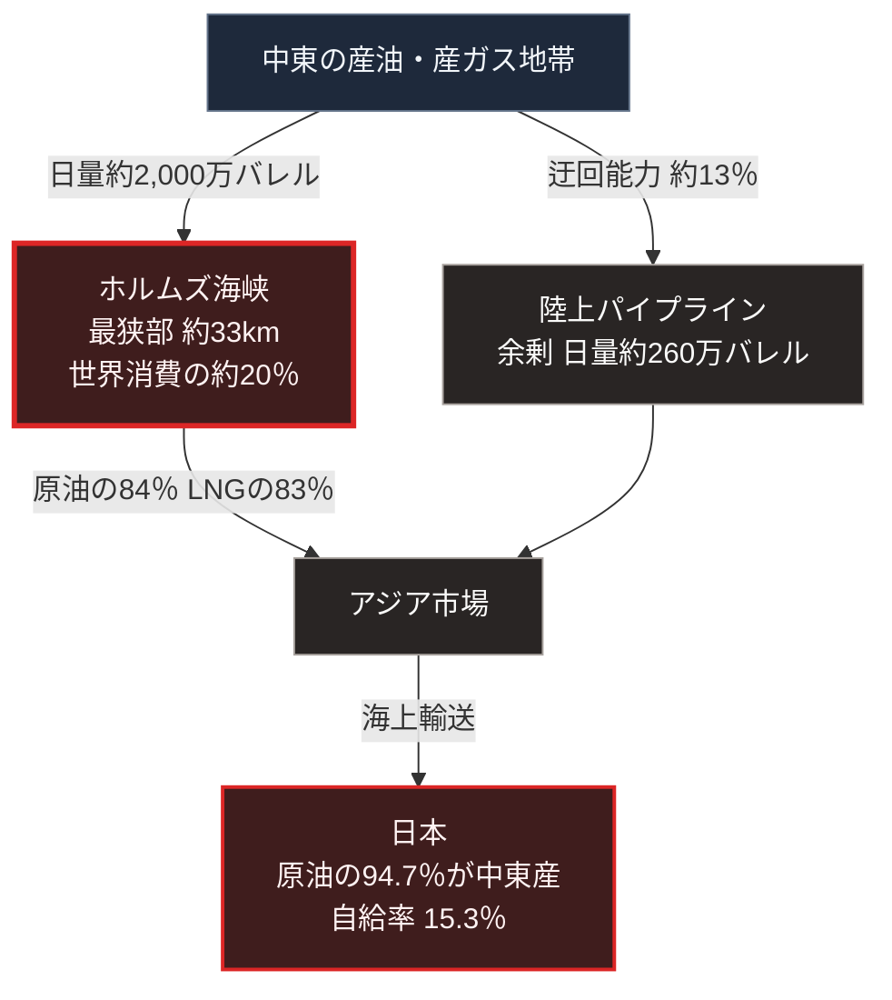

### 序論：本章が扱う範囲

本章は、イランおよびイスラエルを当事者とする近年の武力行使について、次の4点を整理します。

第一に、攻撃対象として選択された施設の類型。第二に、海上交通の要衝が持つ構造的な意味。第三に、これらが日本の供給基盤に対して持つ含意。第四に、2026年2月に始まった戦争と、その後にホルムズ海峡で生じた通航困難の経過です。

前章と同様、本章の情報源は国際機関および政府機関の公表資料に限定します。戦況の逐次的な記述は行いません。

### 1. 2025年6月の経緯と攻撃対象

2025年6月12日、国際原子力機関の理事会は決議を採択し、イランが保障措置協定に基づく義務を履行していないと認定しました。同決議は、未申告の場所における核物質と活動について、イランが2019年以降、機関への完全かつ適時の協力を怠ってきたと記述しています [ [ 311 ] ](https://www.iaea.org/sites/default/files/25/06/gov2025-38.pdf) 。

同年6月13日、イスラエルはイランに対する軍事作戦を開始しました。国際原子力機関は同日の声明で、この作戦がイラン国内の核施設への攻撃を含むこと、そしてナタンズの濃縮施設が影響を受けたことをイラン当局が確認したと公表しました [ [ 312 ] ](https://www.iaea.org/newscenter/statements/statement-on-the-situation-in-iran-13-june-2025) 。

同年6月22日、アメリカはフォルドウ、ナタンズ、イスファハンの3か所の核施設を空爆しました。国際原子力機関は同日、これらの施設が攻撃を受けたことを確認しました [ [ 313 ] ](https://www.iaea.org/newscenter/pressreleases/update-on-developments-in-iran-5) 。同機関の事務局長は国際連合安全保障理事会に対し、フォルドウには地中貫通弾によるクレーターが確認できる一方、地下の損傷を評価できる者は機関を含めて存在しないと述べました [ [ 314 ] ](https://www.iaea.org/newscenter/statements/iaea-director-general-grossis-statement-to-unsc-on-situation-in-iran-22-june-2025) 。

同年6月24日、国際連合の事務総長はイランとイスラエルの間の停戦の発表を歓迎する声明を出しました [ [ 315 ] ](https://news.un.org/en/story/2025/06/1164851) 。

以上の経緯において、公的資料によって確認できる攻撃対象は、核関連施設と軍事施設です。エネルギー施設への攻撃については報道が存在しますが、本書の規範に合致する一次資料を確認できないため、本文では扱いません。

これとは別に、紅海においては海上を航行する船舶が攻撃対象となりました。この点は第3節で扱います。

国際原子力機関は、核関連施設の状態と査察に関する情報を継続的に公表しています [ [ 149 ] ](https://www.iaea.org/newscenter/pressreleases) 。国際連合安全保障理事会は、関連する決議および議長声明を公表しています [ [ 151 ] ](https://www.un.org/securitycouncil/) 。

### 2. ホルムズ海峡の構造的な位置

米国エネルギー情報局によれば、2024年においてホルムズ海峡を通過した石油の量は日量約2,000万バレルです。これは世界における石油系の液体燃料消費のうち、およそ20%に相当します [ [ 152 ] ](https://www.eia.gov/todayinenergy/detail.php?id=65504) 。

同局の分析によれば、2024年から2025年第1四半期において、この海峡を通過した量は、世界の海上石油貿易の4分の1を超えています。

同局はまた、2024年においてホルムズ海峡を通過した原油とコンデンセートの84%がアジア市場向けであったと推計しています。

液化天然ガスについては、2024年に世界の貿易量のおよそ20%がこの海峡を通過しました。主たる輸出元はカタールであり、日量約93億立方フィートです [ [ 153 ] ](https://www.eia.gov/todayinenergy/detail.php?id=65584) 。この海峡を通過した液化天然ガスの83%が、アジア市場へ向かっています。

### 3. 紅海における航行の変化

同局は、紅海を通過するタンカーの隻数が2024年に減少したことを報告しています [ [ 154 ] ](https://www.eia.gov/todayinenergy/detail.php?id=63446) 。

この変化は、船舶に対する攻撃の発生を受けて、運航者が喜望峰を経由する航路へ変更したことによるものです。この迂回は、航行距離と所要日数を増加させます。

### 4. 通行の要衝という構造

[第Ⅰ部D-1](war-why-states-fight)で整理した摩擦の類型のうち、「通行と接続をめぐる摩擦」に該当する事例です。

この類型の特徴は、物理的な要衝が限定されている点にあります。ホルムズ海峡の最狭部は約33キロメートルであり、航路帯はさらに狭い範囲に限られます [ [ 252 ] ](https://www.eia.gov/international/analysis/special-topics/World_Oil_Transit_Chokepoints) 。

代替経路は存在しますが、容量に制約があります。サウジアラビアとアラブ首長国連邦は、海峡を経由しない陸上パイプラインを保有しています。米国エネルギー情報局によれば、サウジアラビアの東西パイプラインの能力は日量500万バレルであり、2019年には一時的に700万バレルまで拡張されました。アラブ首長国連邦のパイプラインは日量180万バレルです。同局は、供給途絶時に海峡を迂回できる余剰能力を日量約260万バレルと推計しています [ [ 152 ] ](https://www.eia.gov/todayinenergy/detail.php?id=65504) 。海峡の通過量である日量約2,000万バレルに対して、この能力は約13%にとどまります。

### 5. 日本の原油輸入における中東の比率

資源エネルギー庁によれば、2023年度の原油輸入に占める中東地域の割合は94.7%です。同庁は、2023年のアメリカの中東依存度が9.3%、欧州OECD諸国が16.5%であることと比較し、日本の依存度が極めて高い水準にあると記述しています [ [ 316 ] ](https://www.enecho.meti.go.jp/about/energytrends/202506/html/s-1-3.html) 。

同庁の2026年6月版のエネルギー動向によれば、2024年度の石油の中東依存度は95.9%であり、過去最高を記録しました [ [ 624 ] ](https://www.enecho.meti.go.jp/about/energytrends/2026/pdf/energytrends_01.pdf) 。同庁が2026年3月27日の審議会へ提出した資料は、2025年の原油輸入の中東依存度を94.0%、ホルムズ海峡を経由する供給への依存度を93.0%としています。液化天然ガスの中東依存度は10.8%、ホルムズ海峡への依存度は6.3%です [ [ 614 ] ](https://www.meti.go.jp/shingikai/enecho/denryoku_gas/jisedai_kiban/pdf/005_07_00.pdf) 。

この比率は、次節で述べる2026年の経過によって大きく変化しました。財務省の貿易統計によれば、2026年9月の原油および粗油の輸入量は1,116.6万キロリットルで、前年同月比3.1%の増加でした。このうち中東からの輸入は692.1万キロリットルで、前年同月比30.0%の減少です [ [ 615 ] ](https://www.customs.go.jp/toukei/shinbun/trade-st/2026/2026094.pdf) 。

### 6. 2026年の戦争と海峡の通航困難

2026年2月、アメリカとイランの協議が再開しました。しかし同月28日、イスラエルとアメリカはイランを攻撃し、最高指導者を含む指導部と革命防衛隊の幹部が死亡しました。イランはイスラエルと周辺諸国へ反撃し、その攻撃は周辺国のエネルギー施設を含む民間施設にも及びました。イランはホルムズ海峡の閉鎖に言及し、海峡とその周辺の海域で民間船舶が攻撃を受けました。外務省は、2026年版の外交青書にこの経緯を記述しています [ [ 600 ] ](https://www.mofa.go.jp/mofaj/gaiko/bluebook/2026/html/chapter2_07_02.html) 。

資源エネルギー庁が2026年8月24日に審議会へ提出した資料は、日本側の経緯を日付とともに整理しています。3月1日、日本の海運会社がホルムズ海峡の航行を停止しました。3月16日、政府は民間備蓄の義務量を70日分から55日分へ引き下げ、当面1か月分の国家備蓄原油の放出を決定しました。事態の発生前に海峡を通過した最後のタンカーは、3月21日に日本へ到着しました。放出は3月26日に始まりました。7月7日には、ペルシャ湾内に停船していた元売り向けのタンカーがすべて海峡を通過しました [ [ 601 ] ](https://www.meti.go.jp/shingikai/enecho/shigen_nenryo/pdf/048_03_00.pdf) 。

国際エネルギー機関の加盟国は3月11日、4億バレルの石油を市場へ供給する協調行動に合意しました。同機関は、これを1974年の設立以来6回目で最大の協調行動と位置づけています。あわせて、中東の戦争が世界の石油市場の歴史で最大の供給途絶を生んでいると記述しています [ [ 602 ] ](https://www.iea.org/news/update-on-iea-collective-action-decision-of-11-march-2026) 。10月7日の時点で、この協調行動のもとで放出された量は約3億2,500万バレルです。加盟国の政府が保有する緊急備蓄は、なお約11億バレル残っています [ [ 603 ] ](https://www.iea.org/news/statement-by-iea-executive-director-on-meeting-of-iea-member-governments-on-7-october-2026) 。

経済産業省は2026年10月23日、エネルギー白書が閣議決定されたと公表しました [ [ 611 ] ](https://www.meti.go.jp/press/2026/10/20261023001.html) 。同白書は、その後の経緯を次のように整理しています。4月7日にアメリカとイランが一時停戦し、4月13日にアメリカはイランの港湾に出入りする商船への海上交通の制限を始めました。6月17日、両国は戦闘の終結などに関する覚書に署名しました。覚書が定めた60日の交渉期限は8月16日に到来しましたが、最終合意には至らず、海峡の通航困難な状況は続きました。同白書はまた、中東からの原油調達量が4月に前年同月の約3割まで低下したこと、そして備蓄の放出と中東以外からの代替調達の拡大により、5月以降の原油処理量が前年と同程度に戻ったことを記述しています [ [ 612 ] ](https://www.enecho.meti.go.jp/about/whitepaper/2026/pdf/whitepaper2026.pdf) 。

資源エネルギー庁の審議会は、2026年9月30日に取りまとめを公表しました。それによれば、7月と8月の調達は前年の平月と比べて約10割へ回復する目途が立ちました。同取りまとめは、原油タンカーの事実上ホルムズ海峡を通れない状況が長期にわたって生じたと記述しています [ [ 613 ] ](https://www.meti.go.jp/shingikai/enecho/shigen_nenryo/pdf/20260930_1.pdf) 。

回復には費用が伴いました。同庁の別の資料によれば、2026年4月の製油所の原油処理量は前年同月比で13.7%低下しました。同月のタンカーのスポット運賃は、前年同月の約11倍に達しました。一方、燃料油の国内向け販売量は、3月から5月まで前年同月の97.9%から99.7%の範囲で維持されました [ [ 623 ] ](https://www.meti.go.jp/shingikai/enecho/shigen_nenryo/sekiyu_gas/supply_structure/pdf/001_05_00.pdf) 。

世界の供給については、国際エネルギー機関の石油市場報告が月ごとの数値を示しています。9月11日の報告によれば、8月の湾岸諸国の石油輸出は日量約1,300万バレルで、戦前の水準のほぼ半分でした。北海産原油の指標価格の8月の平均は1バレル91.00ドルで、9月9日には113.48ドルまで上昇しました。2月以降の在庫の取り崩しは累計で5億700万バレルです [ [ 604 ] ](https://www.iea.org/reports/oil-market-report-september-2026) 。10月14日の報告によれば、9月にホルムズ海峡を通過した石油は日量1,090万バレルへ増加し、海峡を迂回した輸出は日量560万バレルでした。湾岸の原油輸出は日量1,390万バレルで、戦前の水準の75%を超えました。一方、石油製品と液化石油ガスの輸出は、戦前の水準の半分を下回っています。北海産原油の指標価格の9月の平均は116.89ドルでした。同報告は、2026年の世界の石油需要を前年比で日量260万バレルの減少と見込み、供給を日量580万バレルの減少と見込んでいます [ [ 605 ] ](https://www.iea.org/reports/oil-market-report-october-2026) 。

迂回路も攻撃を受けました。サウジアラビアのエネルギー省は2026年9月11日、国営通信を通じて、東西パイプラインが複数の攻撃を受けて予防的に停止されたと公表しました [ [ 622 ] ](https://www.spa.gov.sa/en/N2674017) 。アメリカのエネルギー情報局によれば、攻撃の前にこのパイプラインは紅海側のヤンブー港から日量500万バレルを超える輸出を担っていました。送油は9月22日の時点で部分的に再開しました。同局は、中東の生産停止が5月の日量1,090万バレルから9月の480万バレルへ縮小したと推計し、中東からの供給の制約が2026年第4四半期まで続くと仮定しています [ [ 621 ] ](https://www.eia.gov/outlooks/steo/report/global_oil.php) 。

通航の安全については、国際海事機関の事務局長が9月16日、2月28日以降にホルムズ海峡とその周辺で商船への攻撃80件を確認し、少なくとも22人の船員が死亡したと述べました [ [ 606 ] ](https://www.imo.org/en/mediacentre/pressbriefings/pages/stop-attacking-ships-and-seafarers-imo-secretary-general.aspx) 。イギリス海軍の海上貿易の業務部門は、10月25日に情勢報告を公表しました。それによれば、3月1日以降の船舶への事案は累計156件です。ホルムズ海峡の脅威度は、最も高い水準に置かれています。10月22日から24日の72時間にアメリカ軍の支援のもとで通航した船舶は101隻であり、2025年の平均である1日約138隻を大きく下回ります [ [ 607 ] ](https://www.ukmto.org/-/media/ukmto/products/update-108-jmic-advisory-note-25-oct.pdf?rev=32a38b2b56f448f78f85fc33a48a1722) 。

核問題については、国際原子力機関の理事会が2026年9月9日に決議を採択しました。同決議は、2025年6月12日と2026年6月10日の決議がイランの保障措置協定の義務の不履行を認定したことを再確認しています。あわせて、事務局長に対して理事会への報告を続け、その報告を国際連合安全保障理事会へも提供するよう要請しています [ [ 608 ] ](https://www.iaea.org/sites/default/files/documents/gov2026-61.pdf) 。同月1日の事務局長報告によれば、報告期間中にイランは、申告済みの核施設への立入りと情報のいずれも提供しませんでした。同機関が把握している濃縮ウランの総量は2025年6月13日の時点で9,874.9キログラムであり、このうち60%濃縮のものは440.9キログラムです。現在の在庫の所在については、情報を提供できないと記述しています [ [ 609 ] ](https://www.iaea.org/sites/default/files/gov2026-50.pdf) 。

国際連合安全保障理事会は9月17日、イランに関する制裁委員会の専門家パネルの任期延長を求める決議案を採決しましたが、2つの常任理事国の反対により採択されませんでした。理事国は、安保理の制裁が現に効力を持つかどうかについて分裂したままです [ [ 620 ] ](https://press.un.org/en/2026/sc16455.doc.htm) 。

日本政府は制度の面でも対応しました。経済産業省は2026年10月13日、原油等の調達を多角化するための3つの法案が閣議決定されたと公表しました。第一の法案は、指定した水路の利用の合理化に取り組む事業者へ交付金を交付し、その原資を石油製品の製造業者と輸入業者からの納付金で賄います。第二の法案は、外国政府による再保険の引受けの禁止で海上保険の契約が困難となった場合を対象とします。その場合、政府は国内の損害保険会社へ交付金を交付します。第三の法案は、独立行政法人のJOGMEC（エネルギー・金属鉱物の資源機構）へ原油等の輸送事業への出資と債務保証の業務を追加します [ [ 610 ] ](https://www.meti.go.jp/press/2026/10/20261013001.html) 。

貿易全体への影響については、国際連合の貿易開発会議が2026年10月9日に貿易開発報告を公表し、2026年の世界の成長率を2.6%へ減速すると見込んでいます [ [ 619 ] ](https://unctad.org/publication/trade-and-development-report-2026) 。

### 🗺️ 図：日本の一次エネルギー供給と要衝の関係

供給経路の集中と、迂回路の容量を示します。

#### 図の読み方

この図は、上段の産地から下段の日本へ至る縦の経路です。中段は左右2列に分かれます。左列が海峡、右列が陸上の迂回路です。左右の矢印に記した数量の差が、経路の集中を表します。

この図は、[第Ⅱ部A-1](japan-current-state)で示した日本のエネルギー自給率15.3%という数値が、何を意味するかを経路として表現したものです。残る約85%は輸入です。原油については、その94.7%が中東産です。したがって、原油の相当部分が左列の経路を通ります。すなわち、限定された物理的要衝を通過します。

右列の迂回路は存在しますが、容量が不足しています。海峡の通過量に対して約13%にとどまります。したがって、遮断が生じた場合、供給量の減少は避けられません。

ここで重要なのは、確率ではなく構造です。海峡の遮断される確率がどの程度かという問いを、本章では扱いません。扱うのは、遮断された場合に代替経路が存在するかという問いです。

2026年には、この問いが現実のものとなりました。第6節で記述したとおり、海峡の通航は3月以降に事実上困難となり、右列の迂回路も9月に攻撃を受けました。日本の供給量は、備蓄の放出と調達先の変更によって維持されましたが、運賃と原油価格の上昇という費用を伴いました。

[第Ⅰ部D-1](war-why-states-fight)で整理した枠組みに照らすと、この類型の摩擦は交渉による解決が困難です。要衝の管理権は、分割が困難な争点に近い性質を持つためです。フィアロン自身は争点の不可分性の適用に慎重ですが、海峡の通航という争点はその第三の条件に近い事例として位置づけられます。

[第Ⅲ部](future-method)では、この経路が部分的または全面的に制約された場合の影響を、シナリオの一要素として評価します。[第Ⅴ部](42_taoist-wu-wei-non-action)では、供給が制約された状況において、局所的にエネルギーを確保する方式を検討します。

---

### 現代社会構造への射程と本質（本章のまとめ）

本セクションは、著者による解釈です。前節までの記述とは区別して読んでください。

1.  **この事例が示していること**

    前章のウクライナの事例と本章の事例に共通するのは、攻撃対象が軍事施設に限定されないという点です。

    ウクライナでは発電設備と送電網が、中東では核関連施設と紅海を航行する船舶が対象となりました。前者は相手の継戦能力を、後者は経済活動を支える輸送経路を対象とした事例です。

2.  **本質**

    この2つの事例から抽出できるのは、次の構造です。現代の武力行使において、軍事力そのものだけでなく、それを支える供給基盤が標的に含まれる事例が観測されています。

    この選択には合理性があります。軍事力は分散と防護が可能ですが、大規模な供給設備は移動できず、代替に長期間を要するためです。

    [第Ⅰ部D-2](war-technology-evolution)で整理した費用構造の観点からも、同じ結論が導かれます。安価な手段で高価な設備を機能停止させられる場合、攻撃側の費用対効果は最大化されます。

3.  **日本にとっての含意**

    日本のエネルギー供給は、2つの異なる脆弱性を同時に抱えています。

    第一に、輸入経路の集中です。本章で示した海峡が、その中心にあります。

    第二に、国内における設備の集約です。受入基地、精製設備、そして大規模発電所は、限られた箇所に集中しています。

    この2つは独立した脆弱性です。したがって、一方への対処が他方を解決することはありません。[第Ⅴ部](42_taoist-wu-wei-non-action)では、両者に対する設計を分けて検討します。

    2026年の経過は、第一の脆弱性が現実化した事例です。遮断は生じ、代替経路の容量は不足し、供給量は備蓄と調達先の変更で保たれました。これが本書の枠組みにおいて何を意味するかは、[第Ⅲ部-11](observation-record-2026-10)で指標に照らして評価します。
